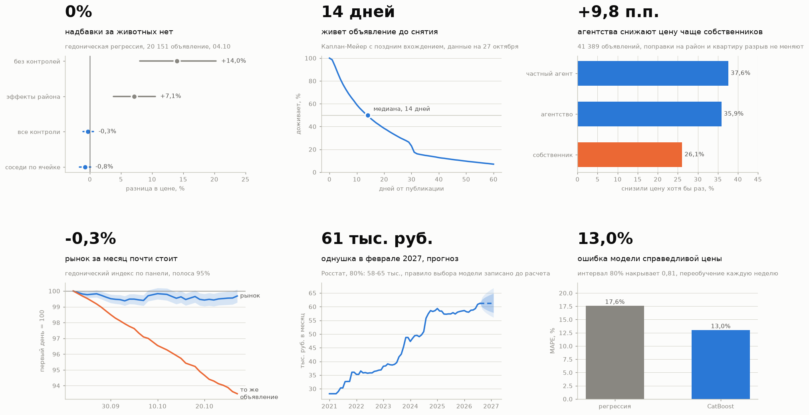
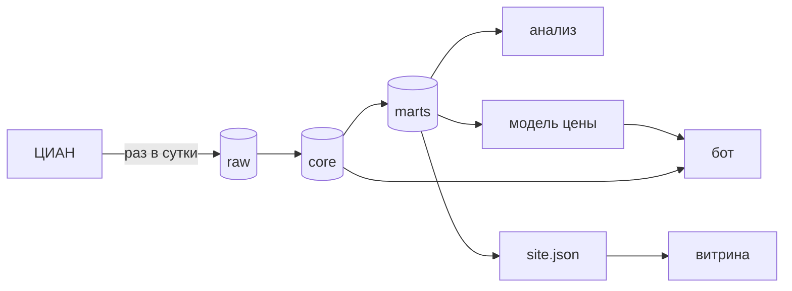
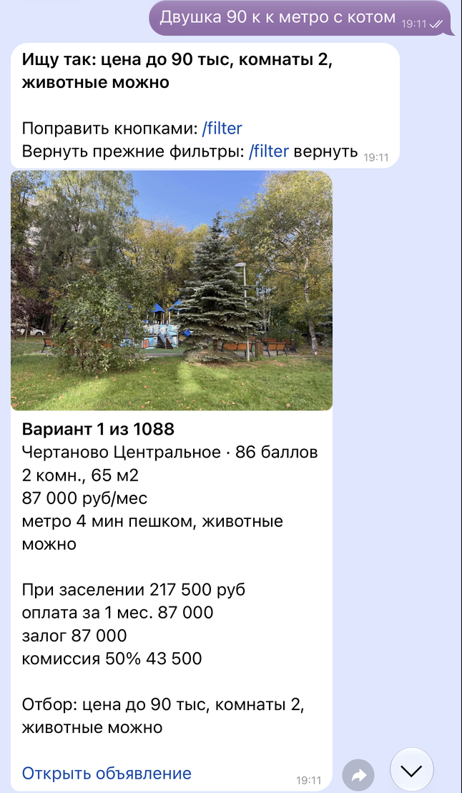
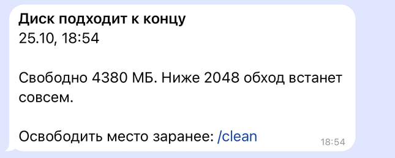

# Рынок аренды в Москве: панель объявлений ЦИАНа

[](https://github.com/nata2627/msk-rent-market/actions/workflows/tests.yml)
[](https://nata2627.github.io/msk-rent-market/)

**[Витрина с живыми данными](https://nata2627.github.io/msk-rent-market/)** · [методы и проверки](methods/) · [бот в телеграме](methods/bot.md)

К концу 2026 года я планирую переехать в Москву и снимать там квартиру.
Истории объявлений площадки не отдают, только срез «прямо сейчас», поэтому с
22.09.2026 я каждый день собираю всю выдачу длительной аренды сама и
отвечаю на вопросы, которые мне нужны перед переездом.

Сейчас в базе <!--n:offers-->64 057<!--/n--> объявлений и
<!--n:observations-->714 908<!--/n--> наблюдений за
<!--n:dates-->34<!--/n--> дат, в сегменте однушек и двушек
<!--n:segment-->44 544<!--/n--> объявлений.



## Что получилось

| вопрос | ответ | как считалось |
|---|---|---|
| [Сколько стоит разрешение держать животных](methods/pets.md) | **нисколько**, −0,3% при интервале от −1,1% до +0,6%. Дешевле на 2,8% стоят квартиры, где животных прямо запрещают | гедоническая регрессия с эффектами района, 20 151 объявление |
| [Сколько живет объявление](methods/survival.md) | **медиана 14 дней**, до месяца доживает каждое пятое. Снятие с публикации не равно сдаче квартиры | Каплан-Мейер с поздним вхождением |
| [Кто снижает цену](methods/drops.md) | **агентства** снижают на 9 п.п. чаще собственников, поправки на район и квартиру разрыв почти не двигают | линейная вероятностная модель, кластерные ошибки |
| [Куда идет рынок](methods/index_forecast.md) | за месяц панели запрашиваемая ставка опустилась на <!--n:ix_hed-->−0,49<!--/n-->%, прогноз на полгода равен нынешнему уровню | гедонический индекс по панели, бэктест четырех моделей на ряде Росстата |
| [Помогает ли снижение цены](methods/cut_effect.md) | снизившие уходят с рынка на <!--n:ce_rel_range-->6-11<!--/n-->% быстрее похожих, вывод неустойчив | модель дневного риска, сопоставление, плацебо |
| [Справедливая цена](methods/price_model.md) | CatBoost ошибается на 13% против 18% у регрессии, отвечает в боте на `/price` | разбиение по времени, конформный интервал, недельный замер дрейфа |

Ответы на первые три вопроса посчитаны на панели 04.10.2026, витрина на
свежих данных показывает тот же срок жизни и тот же разрыв между
агентствами и собственниками. Для прогноза и для оценки снижения цены правило выбора записано в коде
и отправлено в репозиторий отдельным коммитом до первого расчета.

## Как устроено



| узел | что это |
|---|---|
| ЦИАН | выдача длительной аренды, собирается обычным Chrome через Playwright |
| raw | сырые снимки, только пополняются |
| core | объявление × день, пересобирается из raw |
| marts | витрины для анализа, строит dbt |
| анализ | регрессии и выживаемость на numpy и statsmodels |
| модель цены | CatBoost, переобучение раз в неделю |
| бот | телеграм, подбор, оценка цены, тревоги |
| витрина | GitHub Pages, обновляется с машины сбора |

* **Сбор ничем не фильтруется.** Ни по животным, иначе пропадает
  контрольная группа, ни по цене, потому что ее и объясняем. Отбор
  делается разметкой над полными данными.
* **Сырой слой только пополняется.** Телефоны и имена вычищаются до
  записи, автор заменяется соленым хешем. Повторяющаяся карточка
  хранится ссылкой на прежнюю, на 4 днях проверки это 64% строк.
* **Полнота измеряется каждый день.** Площадка отдает не больше
  1512 объявлений на запрос, поэтому выдача делится на корзины по району,
  комнатности и цене, и по каждой корзине сверяется обещанное с собранным.
* **Вся статистика проверяема.** Регрессия, кластерные ошибки и
  Каплан-Мейер написаны на numpy и покрыты тестами.

Подробно в [methods/data.md](methods/data.md).

## Бот

Бот живет на той же машине, что и сбор, и отвечает только своим. Каждый
вечер присылает итог дня, о сбоях сообщает сам и называет команду, которая
их чинит. Подбор квартир приходит одной карточкой с фото, которая
листается кнопками, понравившееся откладывается в `/saved`. Подбор
можно задать фразой, «двушка до 90 у метро с котом»: на
<!--n:nl_n-->80<!--/n--> тестовых фразах правила разобрали точно
<!--n:nl_rules-->78<!--/n-->, GigaChat <!--n:nl_gigachat-->75<!--/n-->.
Цену оценивает команда `/price`.

<p>


</p>

```
/price 2к 45 м2 Хамовники

Типичная 2к 45 м2, Хамовники
130 тыс в месяц (80%: 107-159)
```

Команды и устройство в [methods/bot.md](methods/bot.md).

## Надежность

Панель ценна только непрерывностью: пропущенный день не восстановить
ничем. Сбор идет на отдельной машине по расписанию, сторож каждые
двадцать минут проверяет, жив ли обход, и перезапускает его с места
обрыва. Снаружи машины за ней следит ежедневная проверка в GitHub
Actions: если данные витрины перестали обновляться, приходит письмо.
О сбое бот пишет сам и называет команду, которая его чинит.



| <!--n:ops_period-->с 22 сентября по 27 октября 2026<!--/n--> | дней |
|---|---:|
| календарных | <!--n:ops_calendar_days-->36<!--/n--> |
| покрыто успешным обходом | <!--n:ops_days_full-->32<!--/n--> |
| спасено повторным запуском после сбоя | <!--n:ops_caught_up-->17<!--/n--> |
| потеряно, оба до переезда сбора на отдельную машину | <!--n:ops_days_lost-->2<!--/n--> |

В закрытый день панель забирает в медиане
<!--n:q_completeness-->98,5<!--/n-->% объявлений, которые площадка заявила в
выдаче, недобор есть в <!--n:q_underfilled-->25<!--/n-->% корзин поиска и
обычно равен паре объявлений. Отчет по каждому дню на
[витрине](https://nata2627.github.io/msk-rent-market/), раздел «Насколько
полны данные».

База каждую ночь копируется в Google Drive, зашифрованная ключом,
который есть только у меня, полная копия раз в неделю. Восстановление
проверяется командой `make backup-check`.

Каждая авария разобрана до причины, и после каждой в коде появилась
проверка, список в [methods/operations.md](methods/operations.md).

| ключ | где лежит | срок |
|---|---|---|
| токен бота телеграма | `.env` машины сбора | до отзыва |
| деплой-ключ витрины | машина сбора, запись только в этот репозиторий | выдан 23.10.2026, до отзыва |
| ключ GigaChat API | `.env` машины сбора | выпущен 23.10.2026, срок кабинет не указывает |
| доступ к Google Drive | машина сбора, права только на свои файлы | выдан 24.10.2026, до отзыва |
| ключ шифрования копий | закрытый только на ноутбуке | без срока |

## Стек

| слой | инструменты |
|---|---|
| сбор | Python 3.11, Playwright с обычным Chrome, Docker, cron |
| хранение | PostgreSQL 16, три слоя raw, core, marts, витрины строит dbt с тестами, переход сверен построчно |
| анализ | numpy, statsmodels, собственная реализация регрессии и Каплана-Мейера |
| модель | CatBoost, конформный интервал, MLflow, отдельный контейнер с лимитом памяти |
| выдача | бот на Telegram Bot API без сторонних библиотек, витрина на D3 и GitHub Pages |
| проверки | <!--n:tests-->473<!--/n--> тестов в GitHub Actions на каждый push, сквозная самопроверка на настоящей базе |

## Главные оговорки

* Цены запрашиваемые. Цену сделки площадка не показывает.
* Снятие объявления не равно сдаче квартиры, 5,3% снятий приходятся на
  истечение срока публикации.
* Выборка это то, что опубликовано на ЦИАНе. Часть квартир сдается без
  публикации.
* Решение разрешить животных или снизить цену никто не принимал
  случайно. Оценки сравнивают похожие объявления и причинным эффектом
  не являются.

Полный список в [methods/limitations.md](methods/limitations.md).

## Как воспроизвести

```bash
make venv && cp .env.example .env
make up && make schema   # PostgreSQL 16 в Docker
make test                # тесты без сети и без базы
make selftest            # сквозная проверка на настоящей базе

make narrow              # дневной обход, 1-2 комнаты
make hedonic             # надбавка за животных
make survival            # срок жизни объявления
make drops-analysis      # кто снижает цену
make forecast index      # прогноз и индекс
make price-model         # модель цены
make figures cover       # графики
make readme-numbers      # числа в README и methods/ из базы
```

Числа в README и в `methods/` подставляются из базы командой
`make readme-numbers`, в исходнике они помечены
`<!--n:имя-->значение<!--/n-->`.

```
etl/       сбор, разбор, запись, приватность
src/       анализ, модели, графики, данные витрины
sql/       схема трех слоев и проверки качества
dbt/       витрины в dbt с тестами
scripts/   задания машины сбора и бот
site/      витрина
tests/     тесты на фикстурах, без живых запросов
methods/   подробности методов и проверок
results/   результаты моделей файлами, проверяются без базы
```

## Лицензия

MIT, на код. Данные площадки не перераспределяются, наружу идут только
агрегаты.
