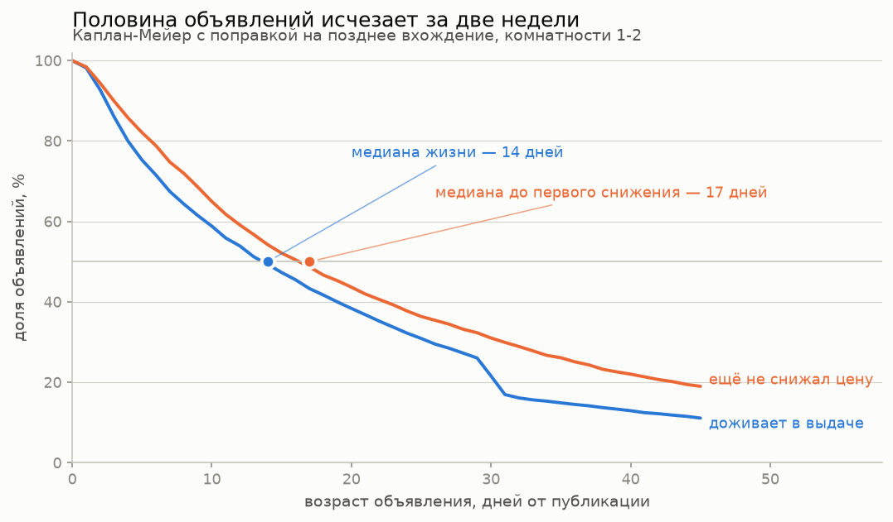
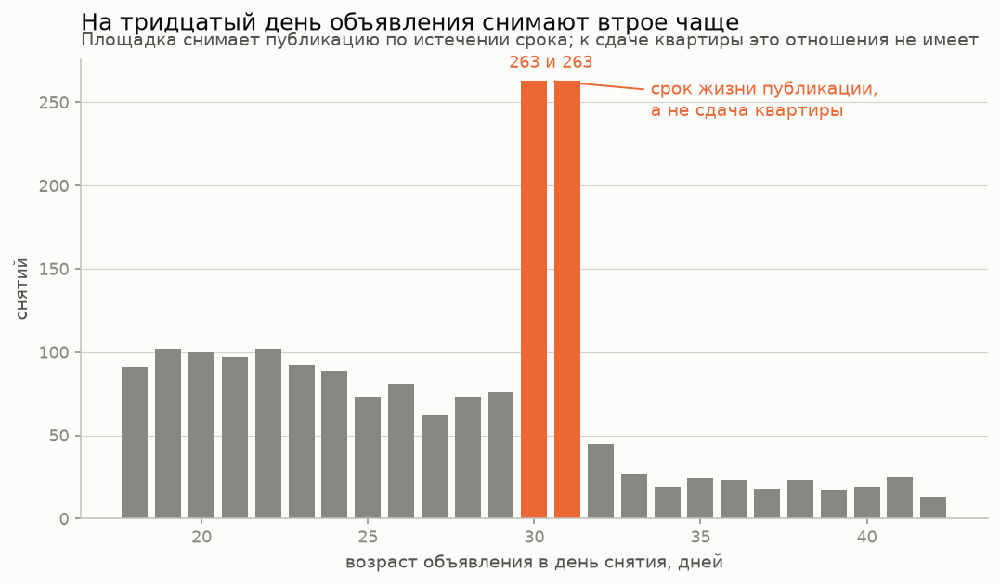
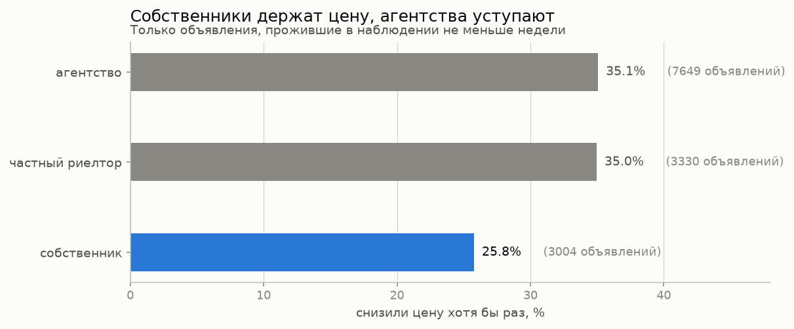
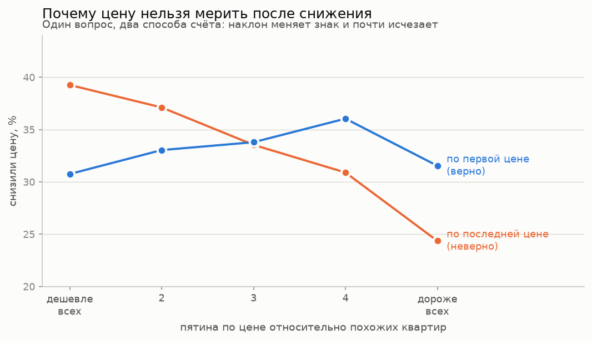

# Рынок аренды квартир в Москве: панель объявлений

[](https://github.com/nata2627/msk-rent-market/actions/workflows/tests.yml)

Самостоятельно собираемая панель объявлений о длительной аренде в Москве.
Цель — измерить, сколько стоит разрешение держать животных, сколько
объявление живёт до снятия с публикации и кто снижает цену.

Повод личный: я переезжаю в Москву в ноябре 2026 и буду снимать квартиру.
Отсюда и выбор вопросов — это то, что мне самой нужно знать, а не
абстрактные упражнения. Оттуда же требование к честности выводов: врать
здесь можно только себе.

История объявлений нигде не хранится и не продаётся: площадки отдают только
срез «прямо сейчас». Поэтому проект устроен так, что сначала начинает
накапливаться панель, а анализ приезжает потом на уже собранных данных.

**Что сделано на сегодня.** Сбор идёт ежедневно по расписанию. В базе
<!--n:offers-->58 940<!--/n--> объявлений,
<!--n:observations-->586 030<!--/n--> наблюдений, панель из
<!--n:dates-->29<!--/n--> дат, из них <!--n:segment-->40 920<!--/n-->
объявлений в искомом сегменте однушек и двушек. Подключены расстояния до
парков, граница МКАД, дедупликация с проверкой по эталону площадки,
исторический ряд Росстата с 2015 года. <!--n:tests-->406<!--/n--> тестов.

Числа в этом абзаце и дальше по тексту, где они помечены в исходнике,
подставляются из базы командой `make readme-numbers`, а не переписываются
руками. Повод завести эту команду был прямой: на 04.10.2026 проверка
нашла семь разошедшихся с данными мест, и ни одно из них себя не
проявляло — текст читался гладко и был неверен.

**Ответы на все три вопроса на 04.10.2026**

| вопрос | ответ | чем меряли |
|---|---|---|
| Сколько стоит разрешение держать животных | **нисколько**, −0,3% при интервале от −1,1% до +0,6% | гедоническая регрессия, 20 151 объявление |
| Сколько объявление живёт до снятия | **медиана 14 дней**, до месяца доживает каждое пятое | Каплан-Мейер с поздним вхождением, 7549 событий |
| Кто снижает цену | **агентства, 35,1% против 25,8% у собственников**, разрыв 9,0 п.п. держится при поправках | линейная вероятностная модель, 13 983 объявления |

Два из трёх ответов получены на панели в тринадцать дней и помечены как
предварительные: они устойчивы к способу счёта, но не ко времени. Главная
оговорка к сроку жизни отдельная и важная — **исчезновение объявления это
не сдача квартиры**, и ровно 5,3% снятий приходятся на истечение срока
публикации, что видно всплеском на тридцатом дне.

**Чего ещё нет.** Сезонности: для неё нужен год наблюдений. И хвоста
кривой дожития дальше сорока пяти дней — его закроет само накопление
панели.

---

## 1. Вопросы

1. **Сколько в рублях стоит пометка «можно с животными».** Гедоническая
   регрессия логарифма цены на характеристики квартиры, с фиксированными
   эффектами района и точным сопоставлением внутри ячеек. `make hedonic`.
2. **Сколько объявление живёт до снятия с публикации.** Каплан-Мейер с
   поздним вхождением: наблюдения цензурированы справа и усечены слева,
   и обе поправки обязательны. `make survival`.
3. **Кто снижает цену и через сколько дней.** Доли по признакам с
   выровненной экспозицией, линейная вероятностная модель с
   фиксированными эффектами района, Каплан-Мейер для срока до первого
   снижения. `make drops-analysis`.

Вся математика — регрессия, устойчивые и кластерные ошибки, Каплан-Мейер —
написана на numpy в `src/`, полсотни строк. Не из принципа, а потому что
вся цена этой работы в том, что именно считается: какие ошибки, на каком
уровне кластеризация, кто в какой момент стоит в знаменателе. Через чужой
вызов этого не видно.

---

## 2. Что лежит в базе

<!--n:sources_table-->
| Источник | Объявлений | Наблюдений | Дат | Период |
|---|---:|---:|---:|---|
| `cian` — собственный сбор | 58 940 | 586 030 | 29 | 22 сентября 2026 — 22 октября 2026 |
| `cian_wayback` — веб-архив | 4 969 | 6 085 | 93 | 23 сентября 2024 — 31 декабря 2025 |
| `cian_xlsx` — ручная выгрузка | 200 | 200 | 1 | 22 сентября 2026 |
<!--/n-->

Плюс внешний ряд Росстата: средняя плата за аренду одно- и двухкомнатной
квартиры в Москве, 140 месяцев с января 2015 года, и помесячный индекс
потребительских цен к нему.

Заполненность у собственного сбора: координаты есть у всех
<!--n:fill_coords-->58 940<!--/n--> объявлений, район — у
<!--n:fill_district-->58 935<!--/n-->. Внутри МКАД оказались
<!--n:inside_mkad-->48 735<!--/n-->. Расстояние до крупного парка
<!--n:park_fill_note-->посчитано у 58 787: у остальных 153 координаты появились позже последнего пересчёта, он догонит их следующим прогоном<!--/n-->.

---

## 3. Как устроен сбор

### Главное ограничение и как оно обойдено

ЦИАН отдаёт 28 объявлений на страницу и не пускает глубже 54-й страницы —
не больше 1512 объявлений на запрос, сколько бы их ни нашлось. Активных
объявлений о длительной аренде в Москве около 26 тысяч. Значит «собрать
всю Москву» одним запросом физически невозможно.

Решение — рекурсивное партиционирование. Корзина это точка в пространстве
(район, комнатность, диапазон цены). Для каждой спрашивается первая
страница и заявленное площадкой число результатов; если оно упирается в
предел, корзина делится по очередной оси. Оси идут от крупной к мелкой.

Диапазон цены делится **в геометрическом среднем**, а не в арифметическом:
ставки распределены примерно логнормально, и середина между 30 и 300
тысячами — 165 тысяч, выше которых почти ничего нет; такое деление не
уменьшило бы корзину. Диапазоны идут встык и покрывают шкалу от нуля до
бесконечности — это инвариант, проверяемый тестами.

Первая ось — район, и справочник районов собирается **из уже скачанных
страниц**, а не отдельным запросом. Служебный эндпоинт, которым он брался
раньше, отвечает 404 — служба у площадки переехала. Искать новый не
понадобилось: каждое объявление несёт свою географию целиком, с теми же
идентификаторами, которые площадка ждёт в параметре запроса. `make
districts-ref` собирает из raw 146 единиц — 125 районов и 21 поселение, —
не обращаясь к площадке вообще. Микрорайоны в нарезку не берутся: они
вложены в районы, и обход запросил бы одни и те же объявления дважды. Узел
«Новая Москва» отбрасывается по тому же признаку — это зонтик над двумя
округами, а не район.

Полнота не предполагается, а измеряется: по каждой корзине в журнал
пишется заявленное площадкой число и реально собранное. На полном обходе
22 сентября площадка заявляла 26 168 объявлений, собрано 23 618 — **90%**.
Расхождение видно в `raw.bucket_underfilled` и в `make checks`.

Заявленному числу нельзя верить на слово, и это выяснилось дорого.
4 октября корзина «вся Москва, 4 комнаты» заявила 1231 объявление, в
предел уложилась, честно прошла все 44 страницы без единой ошибки и
отдала 633 уникальных: примерно с двадцать третьей страницы площадка
начала повторять уже показанное. Неделей раньше та же корзина заявила
1315, порог деления перешагнула, поделилась по районам и собралась на
95%. То есть полнота по четырёхкомнатным зависела от того, с какой
стороны от порога окажется случайное число на этой неделе.

Поэтому решение делить принимается дважды: до листания по заявленному
числу и после листания по собранному. Корзина, отдавшая меньше 90%
обещанного при недоборе от сотни объявлений, делится и проходится заново.
Оба порога выведены из таблицы всех корзин за историю проекта, а не
назначены: правило срабатывает на четырёх корзинах из
<!--n:live_buckets-->6 813<!--/n--> и ловит все
три случая, где потеряна половина. Деление по недобору помечается в базе
отдельно от обычного — «заранее видно, что не влезет» и «выдача пообещала
больше, чем отдала» разные события, и без различия нельзя посчитать, как
часто случается второе.

### Чем нельзя фильтровать на сборе

**Животные.** Без объявлений, где животные не разрешены, не существует
контрольной группы. Отобрать нужное можно потом запросом; расширить
выборку задним числом нельзя.

**Цена.** Это объясняемая переменная. Обрезание выборки по ней смещает все
оценки, причём незаметно. Диапазоны цены используются только как
технический способ нарезки.

### Через какой интерфейс

Данные берутся с публичной страницы выдачи `cian.ru/cat.php`, а не со
служебного эндпоинта `api.cian.ru`. Страница серверного рендеринга несёт
с собой полное состояние приложения — те же карточки по 137 полей, — а
защита относится к ней мягче. Параметры адреса не угаданы: они взяты из
`paginationUrls`, которые площадка строит себе сама.

Темп: один поток, пауза 2–3,5 секунды со случайным джиттером, браузерный
клиент, экспоненциальное отступление при ошибках. Полный обход — около
790 запросов и полтора часа.

### История транспорта, как она была

Это стоит описать честно, потому что путь был нетривиальный.

1. Первый же программный запрос из Python получил страницу-заглушку
   `cian_waf_block`. Адрес — домашний Ростелеком, не VPN и не хостинг;
   в браузере с того же адреса сайт открывался нормально.
2. Установка сессии (сначала главная, потом выдача — как делает браузер)
   не помогла: заглушка приходила уже на главную.
3. Переход со служебного API на публичную страницу — правильный шаг сам
   по себе, но блокировку он не снял.
4. Playwright поверх настоящего Chrome в **headless**-режиме — HTTP 403.
5. Playwright поверх настоящего Chrome в **обычном** режиме — работает.

Итог: сбор идёт через настоящий установленный Chrome с обычным профилем,
который сам заходит на главную и получает куки. Отличие от ручного
просмотра только в том, что на «дальше» нажимает скрипт.

Чего в репозитории нет и не будет: подделки отпечатка TLS, патчей,
скрывающих автоматизацию, ротации прокси, решения капчи. Блокировка
распознаётся отдельным типом исключения и останавливает обход, а не
ускоряет его.

Для сравнения: готовый открытый парсер ЦИАНа, проверенный на той же
машине, за несколько минут сделал 1480 запросов, не получил ни одного
объявления и не заметил, что заблокирован.

---

## 4. Устройство данных

Три слоя.

```
raw    сырые снимки       только добавляются
core   панель             объявление × дата снимка, история цен
marts  витрины            медианы, сегмент, подешевевшие
```

`core.offer` хранит то, что у квартиры не меняется (площадь, этаж, адрес,
координаты) плюс даты жизни объявления; `core.offer_observation` — то, что
меняется, по строке на каждую дату снимка. В одной таблице площадь
дублировалась бы в каждом наблюдении, а изменение цены было бы неотличимо
от исправления опечатки.

Идемпотентность держится на ключе `(source, offer_id, snapshot_date)`.
`core.price_change` — представление поверх оконной функции, а не таблица:
разъехаться с панелью не может. Предыдущая цена берётся по предыдущему
**наблюдению**, а не по календарному дню.

### Персональные данные

Площадка отдаёт в карточке телефон автора и его имя. В хранилище они не
попадают вовсе: `etl/privacy.py` вычищает их до записи, рекурсивно по всей
структуре карточки. Идентификатор автора заменяется солёным хешем — по
нему считается, сколько объявлений у одного продавца, но список людей из
базы не собрать. Тип продавца, рейтинг и стаж остаются: они публичны и
нужны как объясняющие переменные.

Это сделано не «на всякий случай». Для физического лица, собирающего
данные для себя, хранение телефонов законно (152-ФЗ, ст. 2 ч. 2). Но
проект публичный, и любой скриншот или выгрузка иначе становятся
распространением чужих персональных данных.

**В репозиторий не выкладываются ни база, ни сырые снимки, ни выгрузки.**
Публикуются код и агрегаты: медианы, коэффициенты, графики.

### Четыре состояния «животных»

`allowed` / `forbidden` / `negotiable` / `unknown`, а не булев флаг.
«Запрещено» и «не указано» — разные вещи, и схлопывание их в `false`
смешало бы надбавку за животных с надбавкой за заполненную анкету.

Особенности площадки, определившие конструкцию:

* в JSON выдачи поля про животных **нет вовсе** (проверено на живой
  карточке: 137 полей, ни одного про животных);
* в анкете есть только галочка «можно с животными» — состояния
  «запрещено» не существует, пустое значение означает «не отметили».

Насколько хватает текста описания — измерено, а не предположено. По
официальной выгрузке в Excel, где анкетная галочка есть (`make
pets-calibrate`), на 200 объявлениях:

| | правило по тексту дало вердикт | молчит |
|---|---|---|
| галочка стоит (116) | 46 (40%) | **70 (60%)** |
| галочки нет (84) | 17 | 67 |

Ложных запретов ноль. Отсюда двойной проход в сборщике: каждая корзина
обходится без фильтра (полный набор, контрольная группа цела) и с
фильтром площадки, метка ставится по разнице множеств. Источник вердикта
хранится отдельной колонкой `pets_source`.

### Расстояние до парка

OpenStreetMap метит тегом `leisure=park` и Измайловский лес, и сквер между
двумя домами: медианный контур по Москве — **0.21 га**. По расстоянию до
любого парка «зелень рядом» оказывается у 88% объявлений, и переменная
не различает ничего. Поэтому считаются два расстояния, рабочее — до парка
**от 10 гектаров** (120 контуров против 3685); по нему «рядом» у
<!--n:park_near_pct-->44%<!--/n--> объявлений, медианное расстояние
<!--n:park_median_m-->1 158<!--/n--> метров.

Здесь честнее сказать, что порог различает **хуже, чем задумывалось**.
На снимке 26.09.2026 «рядом» оказывалось у 17%, и критерий выглядел
острым. По мере роста выборки доля поднялась почти до половины: крупных
парков в Москве много, и километровый радиус накрывает большую часть
города. Контраст с 88% остаётся, то есть переменная всё ещё осмысленна,
но делит она выборку почти пополам, а не выделяет меньшинство. В оценке
варианта это уже учтено полосами расстояния, а не двоичным «рядом или
нет».

Расстояние считается до границы парка, а не до центра. Контуры склеиваются
по названию: крупные парки приходят мультиполигонами, и без склейки
Измайловский не проходит порог площади.

### Дедупликация

Одна квартира висит у нескольких агентств. Блок — дом (координаты с
округлением до 11 метров), обязательное совпадение комнатности, этажа и
площади, плюс хотя бы одно из: одинаковая цена или похожесть минхеша
описания ≥ 0.8. Минхеш считает сама площадка.

Пороги выведены из распределения пар, а не назначены. Из 31 156 пар внутри
домов: характеристики + цена + текст — 40, характеристики + цена — 295,
характеристики + текст — 7, **только характеристики — 331** (не
схлопываются), только текст — 178, только цена — 2082.

Строка «только текст» показывает, почему текст сам по себе не признак:
178 пар с почти одинаковым описанием — это застройщик, разместивший
типовой текст на разные квартиры.

**Допуск по площади относительный** — не меньше метра, но и не меньше 5%
от размера. Агентства указывают площадь по-разному (кто-то с лоджией,
кто-то без), и расхождение растёт вместе с размером квартиры.

**Проверка по эталону.** У ЦИАНа есть собственное определение дублей —
блок «У других арендодателей». Это не полная истина (там только то, что
нашла сама площадка), но полноту по нему измерить можно, и именно по нему
подобран допуск:

| правило | находим из эталонных | схлопываем пар |
|---|---|---|
| ±1 м² | 52.0% | 967 |
| ±1 м² или 3% | 54.7% | 1059 |
| **±1 м² или 5%** | **61.1%** | **1173** |
| ±5 м² | 62.8% | 1295 |

Последняя строка даёт почти ту же полноту, но схлопывает на 122 пары
больше: плоский допуск в пять метров склеивает маленькие квартиры,
которые различаются по-настоящему.

Дедупликация считается по последнему наблюдению каждого объявления, а не
по одному снимку: дубль — свойство квартиры, а не дня. Ограничение одним
снимком роняло полноту с 61% до 21%, просто потому что одна сторона пары
в этот день не наблюдалась.

**Результат: <!--n:dup_groups-->3 807<!--/n--> группы,
<!--n:dup_extra-->4 790<!--/n--> лишних объявлений —
<!--n:dup_share-->8,1%<!--/n--> выборки.**
Остаточная оценка (совпали характеристики, но ни цена, ни текст) — ещё
3,6%. Площадка объявляет 788 пар, но обе стороны есть у нас только у 382;
из них находим 228 — 59,7%, пропускаем 154.

**Медиана при этом не меняется вообще**
(<!--n:median_1-->60 000<!--/n--> у однокомнатных и
<!--n:median_2-->85 000<!--/n--> у двухкомнатных до и после), среднее
сдвигается на 0,9%. Ожидание, что дубли ломают статистику, на данных не
подтвердилось.

---

## 5. Что уже видно в данных

Это ещё не ответы на исследовательские вопросы — это то, что видно
без моделирования.

**Сверка с Росстатом.** Росстат на август 2026: однокомнатная в Москве
61 205 руб. Медиана по нашему сбору — <!--n:median_1-->60 000<!--/n-->.
Разница 6%, и она объяснима: у нас запрашиваемые цены, у них
фактические. Два независимых источника сошлись.

**Аренда одиннадцать лет отставала от инфляции, потом обогнала.**
Номинально с 2015 по 2026 рост в 2,3 раза, реально — всего +12%. До 2021
года аренда в реальном выражении дешевела (−15% за пять лет), затем за
три года отыграла всё.

**Ноябрь — один из самых дорогих месяцев для входа.** Сверх инфляции
аренда дорожает в августе на 1,94 п.п. и в ноябре на 1,29 п.п.; дешевле
всего февраль, март и апрель. Считано по 22–24 наблюдениям на месяц.

**У площадки есть своя оценка цены.** Поле `goodPrice` заполнено у
<!--n:good_price-->24 199<!--/n--> объявлений: метка вроде «Хорошая цена» и диапазон «52 000—63 000
руб./мес». Это оценка чужой модели той же величины, которую моделируем
мы, — готовый ориентир для сравнения качества собственной регрессии.
Нашлось через журнал нераспознанных полей, ради которого он и заведён.

**Сырая разница по животным поменяла знак, пока копились данные.** На
снимке 26.09.2026 медианы совпадали до рубля. Сейчас так:

<!--n:pets_raw_table-->
| состояние | однокомнатные | двухкомнатные |
|---|---:|---:|
| разрешено | 58 650 | 85 000 |
| запрещено | 64 000 | 80 000 |
| по договорённости | 60 000 | 80 000 |
| не указано | 63 000 | 85 000 |
<!--/n-->

Разница появилась, но **у однокомнатных и двухкомнатных она разного
знака**: у однушек с разрешёнными животными медиана на 5 000 ниже, чем у
запрещающих, у двушек на 2 400 выше.

Это не ответ на вопрос исследования и даже не его начало. Сырая разница
смешивает животных с районом, площадью и всем остальным, а вдобавок, как
видно, не держит даже знак при делении выборки надвое. Что от неё
останется после контролей, видно в разделе 6 — там разница исчезает
вовсе.

Запомнить стоит именно это: величина, которая за две недели сошла с нуля
и смотрит в разные стороны у соседних комнатностей, выводом быть не
может. Отсюда и вся возня с контролями и сопоставлением — не ради
красоты метода, а потому что без них числа означают что угодно.

---

## 6. Первый вопрос: надбавка за животных

**Короткий ответ: надбавки нет.** Две одинаковые квартиры в одном районе,
одна с разрешёнными животными, другая без, стоят одинаково. Разница
−0,3% при интервале от −1,1% до +0,6% — это ноль, а не маленький эффект.

Ответ проверен на вдвое больших данных и устоял. Первая оценка сделана
25.09.2026 на 16 007 объявлениях, вторая 04.10.2026 на 20 151 — вывод не
изменился, а скидка у запрещающих стала отчётливее.

Модель гедоническая: `log(цена)` объясняется площадью, комнатностью,
этажом, возрастом дома, временем до метро, материалом стен, мебелью,
типом продавца и фиксированными эффектами района. Ошибки устойчивы к
гетероскедастичности и кластеризованы по району — объявления внутри
района не независимы. Оценка считается на numpy: `make hedonic`.

| спецификация | 25.09.2026 | 04.10.2026 | 95% интервал на 04.10 |
|---|---:|---:|---|
| разница средних, без контролей | +2,3% | +14,0% | +8,0%; +20,3% |
| фиксированные эффекты района | −0,8% | +7,1% | +3,8%; +10,5% |
| **полные контроли и район** | **+0,2%** | **−0,3%** | **−1,1%; +0,6%** |
| сопоставление внутри ячеек | −0,5% | −0,8% | −1,7%; +0,1% |

Ячейка — «район × комнатность × площадь с шагом 10 м² × минуты до метро
с шагом 5». На снимке 04.10 их 5926; сравниваются только соседи по
ячейке. Это самая осторожная из оценок, и она тоже даёт ноль.

Обратите внимание на первые две строки. Без контролей разница выглядит
как +14%, с одними лишь районами — как +7%, и обе величины значимы.
Разрешение держать животных просто чаще встречается у квартир, которые
дороже по другим причинам. Вся эта разница съедается контролями, и
именно поэтому сырые сравнения в этом вопросе бесполезны.

**Интереснее другое.** Если взять все четыре состояния сразу, база —
объявления, где про животных ничего не сказано:

| состояние | 25.09.2026 | 04.10.2026 | t на 04.10 |
|---|---:|---:|---:|
| разрешено | −0,3% | **−0,9%** | −2,0 |
| **запрещено** | **−2,1%** | **−2,8%** | **−4,8** |
| по договорённости | −0,5% | −2,9% | −2,6 |

То есть дело не в надбавке за разрешение, а в скидке при запрете.
Квартиры, где животных прямо запрещают, стоят почти на 3% дешевле
сопоставимых, а разрешение не стоит ничего. Это меняет саму постановку
вопроса: искать надо не переплату за питомца, а то, почему запрещающие
арендодатели уступают в цене.

Новое на 04.10: в минус относительно молчащих ушли **все три** заполненных
состояния. Дешевле оказываются не те, кто разрешает, а те, кто вообще
заполнил анкету. Объяснения у этого пока нет, и вписывать его в ответ
рано — записано как хвост.

**Почему это не причинный эффект.** Никто не бросал монетку, решая,
разрешить ли животных. Контроли убирают различия, которые видны в
выдаче; состояние квартиры, терпимость хозяина, его срочность — не
видны и остаются в оценке. Честная формулировка: «разница в ставке между
сопоставимыми объявлениями», а не «эффект разрешения».

**Границы применимости.** Оценка на 04.10.2026 построена на 20 151
объявлении и 146 районах. Три контроля выброшены самой оценкой за
отсутствием разброса: стиральная машина, посудомойка и кондиционер в
выдаче поиска не приходят вовсе — о выброшенных контролях модель
сообщает сама, потому что молча пропавший контроль выглядит как учтённый.

---

## 7. Второй вопрос: сколько живёт объявление

> Числа и графики этого раздела посчитаны на снимке **4 октября 2026**
> командой `make survival`. Счётные числа по остальному тексту
> обновляются ежедневно, модельные — нет: они пересчитываются осознанно,
> и дата у них своя.



**Медиана 14 дней.** Половина объявлений сегмента исчезает из выдачи за
две недели после публикации. До месяца доживает каждое пятое, до
полутора — каждое девятое.

| возраст, дней | в группе риска | снято в этот день | доживает |
|---:|---:|---:|---:|
| 1 | 6236 | 112 | 98,2% |
| 3 | 5469 | 396 | 86,0% |
| 7 | 4425 | 253 | 67,4% |
| **14** | 3222 | 120 | **49,3%** |
| 21 | 2383 | 97 | 36,8% |
| 30 | 1532 | 263 | 21,6% |
| 31 | 1227 | 263 | 17,0% |
| 45 | 536 | 20 | 11,1% |
| 60 | 316 | 11 | 7,0% |

### Почему просто посчитать среднее нельзя

Две ловушки, и каждая по отдельности даёт правдоподобный и неверный
ответ.

**Цензурирование справа.** Объявление, которое висит до сих пор, прожило
«не меньше чем». Выбросить такие значит оставить одни короткоживущие и
занизить срок вдвое. Отсюда Каплан-Мейер, а не среднее.

**Левое усечение.** Панель началась 22.09.2026, и объявления, успевшие
появиться и исчезнуть до этого дня, нам не попались вовсе. Среди
доживших до начала наблюдения долгожителей больше, чем на рынке.
Лечится поздним вхождением: объявление входит в группу риска не с
рождения, а с того возраста, в котором мы его впервые застали.

Пользоваться поздним вхождением можно потому, что дата публикации
известна у всех объявлений до единого и она не двигается. Это проверено
прямо, а не предположено: объявлений, у которых первая встреча раньше
даты публикации, **ноль из 38 990**. Если бы площадка обновляла дату при
поднятии объявления, такие случаи были бы — запись в панель идёт через
`coalesce`, и новое значение затёрло бы старое.

### Проверка на неоднородность

Если риск снятия зависит только от возраста, кривая по всем объявлениям
и кривая по тем, кого видели с рождения, обязаны совпасть. Они
расходятся, и расхождение растёт с возрастом.

| возраст | все объявления | только видели с рождения | разница |
|---:|---:|---:|---:|
| 3 | 86,0% | 82,2% | +3,9 п.п. |
| 5 | 75,3% | 71,2% | +4,1 п.п. |
| 7 | 67,4% | 61,1% | +6,3 п.п. |
| 9 | 61,5% | 53,6% | +7,9 п.п. |

Читается это так: объявления, дожившие до начала панели, устойчивее
только что опубликованных. Поздним вхождением такая неоднородность не
лечится — она лечится моделью с ненаблюдаемой «хрупкостью» либо
накоплением собственной когорты. Поэтому медиана 14 дней это верхняя
граница для свежих объявлений и нижняя для рынка в целом, а не одно
точное число.

### Пятая часть снятий — это не сдача квартиры



На тридцатый и тридцать первый день снимается по 263 объявления при
обычных шестидесяти в день. Это не поведение арендаторов, а срок жизни
публикации на площадке. Над фоном лишними оказываются **5,3% всех
снятий**, и к сдаче квартиры они отношения не имеют.

Правило «`disappeared_date` это не дата сдачи» в проекте записано давно.
Теперь у него есть механизм и размер.

---

## 8. Третий вопрос: кто снижает цену

> Снимок **4 октября 2026**, команда `make drops-analysis`.

За 13 дней панели в сегменте 7092 снижения цены против 833 повышений,
то есть **восемь к одному**. Медианная глубина снижения 5,6%, четверть
снижений глубже 7,7%.



### Снижает тот, кто продаёт не своё

| признак | значение | объявлений | снизили цену |
|---|---|---:|---:|
| продавец | агентство | 7649 | **35,1%** |
| продавец | частный риелтор | 3330 | 35,0% |
| продавец | **собственник** | 3004 | **25,8%** |
| комнат | 1 | 6025 | 34,8% |
| комнат | 2 | 7958 | 31,7% |
| животные | разрешено | 3407 | 35,5% |
| животные | не указано | 8022 | 31,8% |
| район | средний | 4588 | 34,0% |
| район | дешёвый | 1836 | 28,6% |

Разрыв между агентством и собственником — девять процентных пунктов, и
это самая большая разница во всей таблице. Доли посчитаны только по
объявлениям, прожившим в наблюдении не меньше недели: иначе ответом на
вопрос «кто снижает» оказалось бы «кто дольше висит».

Разрыв не подменяет собой что-то другое. Линейная вероятностная модель с
фиксированными эффектами района, поправкой на комнатность, площадь,
число фотографий, расстояние до метро, животных и срок висения, с
ошибками, кластеризованными по району:

| признак | эффект, п.п. | ошибка | t |
|---|---:|---:|---:|
| **агентство** против собственника | **+9,0** | 1,1 | 8,0 |
| частный риелтор против собственника | +8,8 | 1,2 | 7,4 |
| животные разрешены | +3,7 | 1,0 | 3,8 |
| две комнаты против одной | +0,1 | 1,1 | 0,1 |
| первая цена относительно похожих | −0,2 | 1,4 | −0,2 |

Сырая разница 9,3 п.п., с поправкой на всё перечисленное 9,0 п.п. Почти
не сдвинулась.

### Ловушка, из-за которой ответ получается с обратным знаком



Напрашивающийся вопрос — снижают ли те, кто изначально просил выше
рынка. Напрашивающийся способ счёта — взять отношение цены объявления к
медиане похожих и посмотреть доли по пятинам.

Так делать нельзя. В витрине лежит **последняя** цена, и объявление,
которое уже снизило цену, из-за этого самого снижения выглядит дешёвым
относительно рынка.

| пятина по цене к похожим | по последней цене (неверно) | по первой цене (верно) |
|---|---:|---:|
| дешевле всех | 39,3% | 30,8% |
| 2 | 37,1% | 33,0% |
| 3 | 33,5% | 33,8% |
| 4 | 30,9% | 36,1% |
| дороже всех | 24,4% | 31,5% |

Первый расчёт даёт сильный наклон и неверный знак: «дешёвые снижают
чаще». Во втором наклон почти исчезает, и слабый максимум остаётся у
четвёртой пятины. Правильный ответ скучнее неправильного: **цена
относительно рынка почти ничего не говорит о готовности торговаться, а
тип продавца говорит.**

### Через сколько дней

| возраст, дней | ещё не снижали цену |
|---:|---:|
| 3 | 89,9% |
| 7 | 74,7% |
| 14 | 54,3% |
| **17** | **50,0%** |
| 21 | 42,0% |
| 30 | 31,0% |
| 45 | 19,0% |

Медиана до первого снижения — 17 дней, то есть позже медианы срока жизни
объявления. Большинство объявлений исчезает, так и не тронув цену.

Читать таблицу надо с поправкой: объявление, снятое на третий день,
здесь цензурировано, а не «не снизило цену». Среди тех, кто доживает,
снижение — обычное дело.

### Чего эти числа не говорят

Что агентство «готово торговаться». Мы видим изменение цены в
объявлении, а не разговор с арендатором. Собственник может уступить при
встрече и не тронуть объявление; агентство может снижать цену по
внутреннему регламенту, не собираясь уступать дальше.

---

## 9. Бот: панель в телефоне

Сбор идёт на отдельной машине, которая всегда включена, а человек бывает
в разъездах. Поэтому у панели есть бот в телеграме: он докладывает о
беде сам и выполняет то, за чем иначе пришлось бы идти в терминал.

### Он говорит, когда что-то сломалось

Поводов восемь: упал сбор, упал шаг после сбора, не поднялась база, снят
заклинивший замок, замок снять не удалось, диск ниже двух гигабайт и
ниже пяти, проба площадки не уложилась в срок. Плюс **вечерний пульс** —
итог дня, который приходит всегда:

```
Итог дня 22.10: день покрыт

1-2 комнаты: 17271 из 16500 (104%)
Снятий за день: 0
```

Пульс важнее тревог: он приходит каждый вечер, и его **отсутствие** —
единственный способ узнать, что молчит машина, а не рынок.

Одно сообщение на повод за шесть часов, иначе сторож, который ходит раз
в двадцать минут, отправил бы одну и ту же беду семьдесят два раза в
сутки.

### Он чинит то, что ломается чаще всего

Сообщение о беде называет команду, а не инструкцию для терминала: в
поезде консоли нет.

| команда | что делает |
|---|---|
| `/status` | собрано за день, покрытие, свежесть витрин, диск, память |
| `/clean` | вычистить кеш браузера, не трогая куки |
| `/unlock` | снять заклинивший замок |
| `/catchup` | догнать день |
| `/dbup` | поднять упавшую базу |

Команды, которые что-то делают, сами отказываются работать посреди
обхода: второй браузер в том же профиле ломает сессию площадки обоим.
`/unlock` вдобавок не трогает замок, если журнал прогона писался меньше
пяти минут назад — значит обход жив.

### Он показывает подбор

```
Подбор: 1-5 из 330 подходящих

Отбор: цена до 80 тыс, площадь от 45 м2, комнаты 1,2,
животные можно, парк в километре, внутри МКАД
```

Дальше идут варианты — каждый фотографией с подписью: балл, район,
комнатность, площадь, цена, метро и ссылка. Под ними кнопка «Следующие
5».

Фильтры задаются кнопками или текстом (`/filter цена 90`), живут между
запусками и **свои у каждого чата**. Новому чату отбор ставится
автоматически — 1-2 комнаты и потолок цены по медиане сегодняшней
выдачи, — и бот честно пишет, что поставил его сам: пустой отбор означал
бы не «показать всё», а «показать самое дорогое». Балл за цену в проекте
перевёрнут намеренно (см. раздел 5), поэтому без потолка наверх лезут
квартиры за три миллиона.

### Кому он отвечает

Ролей три. Владелица — всё. Гость, перечисленный в `.env`, — только
смотреть: подбор, рынок, свежесть данных, свои фильтры. Журнал прогона
гостю не отдаётся, в нём устройство машины. Чужому не приходит ничего,
даже отказа: ответ подтвердил бы, что бот живой и что-то умеет.

### Как это работает, если машина за NAT

Снаружи к машине сбора не подключиться, и webhook телеграма до неё не
дотянется. Поэтому бот не ждёт входящих, а сам раз в минуту спрашивает
телеграм, держа соединение открытым до пятидесяти секунд. Открытых
портов не добавилось ни одного.

Отдельного демона нет намеренно: процесс живёт не дольше семидесяти
секунд, дальше его сменяет следующий запуск из `cron`. В этом проекте
уже был зависший процесс, который девятнадцать часов держал замок и чуть
не съел день панели.

## 10. Эксплуатация

Панель ценна только непрерывностью. Вчерашней выдачи площадка не
отдаст, поэтому пропущенный день не восстанавливается ничем, и главная
работа здесь в том, чтобы сбор шел каждый день без участия человека.
Ниже счет по журналу прогонов `raw.collection_run`, числа подставляются
командой `make readme-numbers`.

| что | сколько |
|---|---:|
| дней панели, <!--n:ops_period-->с 22 сентября по 22 октября 2026<!--/n--> | <!--n:ops_calendar_days-->31<!--/n--> |
| покрыто успешным прогоном | <!--n:ops_days_full-->27<!--/n--> |
| собрано частично, без успешного прогона (<!--n:ops_days_partial_dates-->13 и 17 октября<!--/n-->) | <!--n:ops_days_partial-->2<!--/n--> |
| потеряно (<!--n:ops_days_lost_dates-->9 и 11 октября<!--/n-->) | <!--n:ops_days_lost-->2<!--/n--> |
| дней, спасенных повторным запуском после сбоя | <!--n:ops_caught_up-->15<!--/n--> |
| прогонов всего | <!--n:ops_runs-->73<!--/n--> |
| из них успешных | <!--n:ops_runs_ok-->33<!--/n--> |
| упавших или прерванных | <!--n:ops_runs_bad-->40<!--/n--> |
| часов обхода | <!--n:ops_hours-->105<!--/n--> |
| запросов к площадке | <!--n:ops_requests-->41 440<!--/n--> |

Покрытым день считается только при успешном прогоне, потому что от
этого зависят даты снятий с публикации. Упавших прогонов больше, чем
успешных, и так задумано. Обход, у которого страница не открылась трижды,
честно падает, а сторож через двадцать минут запускает его снова с
места обрыва. Ночной полный обход проходит так в два-четыре захода.

Отчего падали прогоны, по записи в журнале.

<!--n:ops_fail_table-->
| причина | прогонов |
|---|---:|
| страница не далась после трех попыток, обход продолжен следующим запуском | 32 |
| прерван снаружи: сигнал, перерегистрация расписания, переезд | 3 |
| пробный прогон с пределом запросов | 1 |
| браузер закрылся посреди обхода | 1 |
| завис без итога, закрыт задним числом | 1 |
| пустой обход: ни одна корзина не прочиталась | 1 |
| похоже на блокировку, обход остановил себя сам | 1 |
<!--/n-->

### Аварии и что после каждой поставлено

Каждая строка ниже разобрана до причины, и после каждой появилась
проверка в коде. Договоренность помнить ничего не стоит.

| когда | что случилось | что поставлено |
|---|---|---|
| 27.09 | одна неоткрывшаяся страница роняла весь дневной сбор | повторы страницы, сбой одной страницы не валит обход |
| 28.09 | ноутбук засыпал посреди обхода | запрет сна на время прогона, ежедневный обход перенесен на полдень |
| 04.10 | обход начался от батареи и собрал ноль, похоже было на блокировку | проверка питания до начала, догон пропущенного дня одной командой |
| 07.10 | окно браузера закрыли руками на середине | день догнан, снятия считаются только по успешным обходам и не испортились |
| 09.10, 11.10 | два дня потеряны, первый из-за питания ноутбука, второй из-за сбоя самой площадки | сбор переехал на отдельную всегда включенную машину, видимый Chrome под Xvfb в контейнере |
| 12.10 | пустой обход записывал себе успех и занижал срок жизни объявлений | пустой обход не покрывает день |
| 12-19.10 | обрывы посреди корзин заставляли перемалывать собранное заново | продолжение с места обрыва, сторож запускает обход по ответу площадки вместо часов |
| 15.10 | диск машины общий с соседями и может кончиться посреди обхода | сторож не запускает обход, если свободно меньше двух гигабайт |
| 21.10 | обход заклинил после блокировки и девятнадцать часов держал замок, день почти потерян | срок давности у замка, лимит памяти контейнеру сбора 1,8 ГиБ, все вызовы docker под `timeout` |
| 21.10 | расписание шло на три часа позже, пояс в cron не действовал | часы расписания явно в UTC, расписание лежит файлом в репозитории |
| 22.10 | дашборд десять дней показывал замершую копию базы | перелив базы одной командой и дата данных на самом дашборде |
| 22.10 | о двух предыдущих бедах узнали, только когда спросили сами | доклад о беде в телеграм по восьми поводам и вечерний пульс |

### Что переживет остановку машины

Сбор и бот работают на отдельной машине, которая мне не принадлежит.
Если ее выключат, панель перестанет пополняться и бот замолчит. Код,
этот README с графиками и числами на дату последней подстановки останутся
в репозитории и проверяются без базы.

## 11. Индекс аренды и прогноз

Личный вопрос перед переездом в том, когда входить на рынок и сколько
закладывать. Ответ собран из двух частей. Ряд Росстата за
<!--n:fc_months-->140<!--/n--> месяцев дает прогноз, собственная панель
служит текущим замером. Панель слишком коротка для прогноза, и подгонять
модель под месяц наблюдений было бы самообманом.

Результаты лежат в репозитории файлами и проверяются без базы,
`results/forecast.json`, `results/backtest.csv`, `results/panel_index.json`.
Пересчет командами `make forecast` и `make index`.

### Прогноз по Росстату

Правило выбора модели записано в `src/forecast.py` и запушено отдельным
коммитом до первого расчета (`3c6ba1e`). Кандидатов четыре, случайное
блуждание, сезонный наивный, ETS и SARIMA. Оценка скользящим началом,
24 начала, горизонты от одного до шести месяцев, MAPE по уровню
номинального ряда, среднее по однушкам и двушкам. Сложная модель
заменяет простой ориентир, только если ошибается хотя бы на 10% реже и
ее 80%-интервал накрывает факт в 70-90% случаев.


<!--n:fc_backtest_table-->
| модель | MAPE, % | покрытие 80%, доля | покрытие 95%, доля |
|---|---:|---:|---:|
| случайное блуждание | 1,92 | 0,91 | 0,99 |
| сезонный наивный | 6,43 | 0,74 | 0,93 |
| ETS | 3,24 | 0,78 | 0,93 |
| SARIMA | 2,70 | 0,80 | 0,93 |
<!--/n-->

По правилу выбрано <!--n:fc_chosen-->случайное блуждание<!--/n-->.
Ни ETS, ни SARIMA не обыграли прогноз «как в прошлом месяце». На первом
месяце все почти равны, к шестому отставание в среднем растет: модели
продолжают рывок цен 2023-2024 годов, которого дальше не было. Сезонный наивный хуже
всех, потому что год назад рынок стоял на другом уровне. Интервал
случайного блуждания шире нужного (накрывает факт чаще заявленных 80%),
то есть он скорее осторожен.

<!--n:fc_forecast_table-->
| комнат | август 2026, руб. | прогноз на февраль 2027, руб. | 80% | 95% |
|---|---:|---:|---|---|
| 1 | 61 205 | 61 205 | 57 786 - 64 825 | 56 055 - 66 827 |
| 2 | 74 341 | 74 341 | 70 098 - 78 840 | 67 951 - 81 331 |
<!--/n-->

Читать так. Лучшая оценка на полгода вперед равна нынешнему уровню, а
80%-интервал шириной около шести процентов в обе стороны. За последний
год номинальная ставка однушки выросла на
<!--n:fc_yoy_1-->5,9<!--/n-->%, в реальном выражении на
<!--n:fc_yoy_real_1-->1,1<!--/n-->%.

**Сезонность слабая и неустойчивая.** Декомпозиция STL за последние
три года дает размах около <!--n:fc_season_amp-->3,7<!--/n-->% между
лучшим и худшим месяцем, но месяц пика в номинальном и реальном ряду
разный. Выигрыша от того, чтобы подгадать месяц переезда, в этих данных
не видно.

### Индекс по панели

Два способа на одной выборке, <!--n:ix_days-->25<!--/n--> дней
успешного сбора, <!--n:ix_rows-->388 241<!--/n--> наблюдений однушек и
двушек без дублей, посуточных и выбросов.

* **Цепной по одним и тем же объявлениям.** Шаг между соседними днями
  сбора равен среднему изменению логарифма цены у объявлений, бывших в
  выдаче оба дня. За месяц <!--n:ix_chain-->−5,7<!--/n-->%.
* **Гедонический.** Регрессия логарифма цены на фиктивные по дате,
  признаки квартиры и эффекты района, ошибки кластерные по объявлению.
  За тот же месяц <!--n:ix_hed-->−0,49<!--/n-->%, 95%-интервал
  [<!--n:ix_hed_ci-->−0,90; −0,09<!--/n-->].


Расхождение двух линий само по себе результат. Объявление, которое
остается на рынке, за месяц дешевеет примерно на шесть процентов,
потому что его цену снижают. Рынок в целом почти стоит, потому что
новые объявления входят по прежним ценам. Цепной индекс поэтому меряет
жизнь объявления и для уровня рынка не годится.

По правилу, записанному заранее, гедонический индекс плоским не
считается, потому что интервал не накрывает ноль. Но величина около полупроцента,
день ото дня индекс гуляет на <!--n:ix_sd_day-->0,09<!--/n-->% со
стойкой автокорреляцией, и его путь не монотонный. Ошибки, кластерные
по объявлению, не учитывают общий для дня шум состава выдачи, поэтому
интервал скорее узок. Осторожный вывод такой. За месяц запрашиваемая
ставка опустилась примерно на полпроцента, и это меньше половины
типичного месячного движения по Росстату.

**С какого месяца панель начнет различать.** Минимально различимое
месячное изменение по дневному шуму <!--n:ix_mde-->0,16<!--/n-->%, а
типичное месячное движение по Росстату <!--n:ix_rosstat_mom-->1,07<!--/n-->%.
Значит, различать панель сможет с первой пары полных месяцев, октября и
ноября 2026, то есть после 30 ноября. Для сезонности нужен год, это
сентябрь 2027.

**Связка с Росстатом пока предварительная.** Полных месяцев панели, по
которым у Росстата уже есть значение, ноль. Сентябрь панели неполный, а
октябрь Росстат еще не опубликовал. Первое сравнение будет «ноябрь к
октябрю». До тех пор никаких выводов о совпадении двух источников нет.

## 12. Ускоряет ли снижение цены уход объявления

**Сначала оговорки, без них число читается неправильно.** Уход
объявления не равен сдаче квартиры, часть снятий это истечение срока
публикации, передумавшие хозяева и смена агента. Снижение цены не
случайно, его делает тот, кому не звонят или кто сдает к сроку.
Контроли убирают видимое, ненаблюдаемое остается в оценке. Поэтому
ниже стоит разница между снизившими и похожими не снизившими в тот же
день и в том же возрасте объявления, и называть ее эффектом снижения
нельзя.

Протокол записан в `src/cut_effect.py` и запушен до расчета (`844cc4f`).
Выборка из <!--n:ce_rows-->341 002<!--/n--> строк объявление-день,
<!--n:ce_offers-->36 001<!--/n--> объявлений однушек и двушек,
<!--n:ce_events-->19 797<!--/n--> подтвержденных уходов. Объявление
входит в группу риска с первого дня, когда его застали, возраст
считается от публикации, последние три дня сбора отрезаны, потому что
уход в них еще не подтвержден.

<!--n:ce_table-->
| оценка | прибавка, п.п. | 95% интервал | база |
|---|---:|---|---:|
| модель риска, все | +0,63 в день | +0,44; +0,82 | 5,73% в день |
| модель риска, видели с рождения | +0,39 в день | +0,03; +0,74 | 6,72% в день |
| модель риска, больше признаков | +0,64 в день | +0,45; +0,83 | 5,73% в день |
| сопоставление, уход за 7 дней | +2,0 | +1,1; +3,0 | 28,8% за 7 дней |
<!--/n-->

**Модель риска.** Линейная вероятностная модель ухода в данный день.
Справа признак «цена уже снижалась», меняющийся во времени, эффекты
района с комнатностью и календарного дня, неделя возраста, цена к
похожим и тип продавца, ошибки кластерные по объявлению. Снизившие
уходят на <!--n:ce_eff-->+0,63<!--/n--> п.п. в день чаще
([<!--n:ce_ci-->+0,44; +0,82<!--/n-->]) при базовом риске
<!--n:ce_base-->5,73<!--/n-->% в день, то есть в
<!--n:ce_ratio-->1,11<!--/n--> раза.

**Сопоставление.** <!--n:ce_treated-->8 588<!--/n--> объявлений,
впервые снизивших цену, против не снижавших в тот же день, той же
комнатности, той же недели возраста и того же квинтиля цены к похожим.
До снижения траектория у обеих групп одна, цену не меняли. Оценка
другим способом дает тот же знак и сопоставимую величину.

**Плацебо.** Записанное в протоколе плацебо ставило ложное снижение в
случайный день внутри наблюдаемого отрезка жизни объявления и дало
<!--n:ce_plc_pre-->+17,6<!--/n--> п.п. Это ошибка протокола, данные тут
ни при чем. Последний день отрезка всегда оказывается «после ложного
снижения», а событие стоит именно на нем, то есть выбор дня подглядывает
в будущее. Исправленный вариант, добавленный после того, как это стало
видно, берет ложный возраст снижения из распределения настоящих и от
судьбы объявления не зависит. Он дает
<!--n:ce_plc_age-->−0,05<!--/n--> п.п. в среднем, интервал накрывает
ноль в <!--n:ce_plc_age_cover-->92<!--/n-->% из
<!--n:ce_plc_reps-->200<!--/n--> повторов.

**Неоднородность меняет ответ.** На когорте, которую видели с рождения,
прибавка примерно вдвое меньше, чем на всех, и по правилу протокола
оценка признана неустойчивой. Объяснение правдоподобное, но не
проверенное: в панель попали и объявления, застанные в середине долгой
жизни, а у них и снижения, и уходы устроены иначе. Дополнительный
признак объявления, число фотографий, оценку не двигает.

**Вывод.** Снизившие цену уходят с рынка немного быстрее похожих, на
<!--n:ce_rel_range-->6-11<!--/n-->% по дневному риску в зависимости от выборки. Сказать, что
снижение ускоряет сдачу, эти данные не позволяют. Uplift в узком
смысле, то есть кому снижение помогает больше, здесь не оценивался:
на месяце панели и при неслучайном снижении такая модель была бы
украшением.

## 13. Справедливая цена и команда /price

Табличная модель, которая переобучается и следит за своей ошибкой. Своя
модель нужна, хотя у площадки есть оценка, по трем причинам.
Оценка площадки есть меньше чем у половины объявлений. Площадка, судя по
всему, оценивает запрашиваемую цену, а панель видит еще и то, что с
рынка ушло. И к оценке полезно приложить, сколько такое объявление
обычно висит.

**Как проверялось.** Единица наблюдения это объявление с ценой и
признаками в день первой встречи. Разбиение по времени, проверка на
объявлениях последних десяти дней, и по группам дублей: одна квартира у
двух агентств целиком уходит в одну часть. Вышло
<!--n:pm_split-->38 656 в обучении, 6 974 в калибровке, 9 558 в проверке<!--/n-->.
Выбросы по цене исключены из обучения. Ориентир, гедоническая регрессия
на признаках раздела 6 с эффектами района, соперник CatBoost на тех же
признаках плюс координаты, условия сделки и техника. Интервал 80%
строится раздельным конформным предсказанием на калибровочной части.

<!--n:pm_table-->
| модель | MAE, руб. | MAPE, % | медиана APE, % | покрытие 80% | полуширина интервала, % |
|---|---:|---:|---:|---:|---:|
| гедоническая регрессия | 20 431 | 17,7 | 13,3 | 0,80 | 31 |
| CatBoost | 15 145 | 13,1 | 9,7 | 0,80 | 22 |
<!--/n-->

<!--n:pm_rooms_table-->
| комнат | объявлений | MAPE регрессии, % | MAPE CatBoost, % | покрытие 80% |
|---|---:|---:|---:|---:|
| студия | 1 123 | 16,2 | 10,2 | 0,89 |
| 1 | 3 750 | 15,8 | 11,9 | 0,83 |
| 2 | 3 288 | 17,7 | 13,4 | 0,79 |
| 3 | 1 186 | 22,1 | 16,3 | 0,72 |
| 4 | 211 | 34,8 | 26,6 | 0,53 |
<!--/n-->

CatBoost ошибается заметно реже регрессии во всех комнатностях.
Покрытие интервала в целом ровно заявленное, но по комнатностям
неравное: у студий интервал с запасом, у трешек и четырешек узок. Один
квантиль на всех так и работает, лечится раздельной калибровкой по
комнатности, когда в проверке наберется достаточно больших квартир.

**Сравнение с оценкой ЦИАНа.** Это сравнение двух моделей, истиной ни
одна не считается. Оценка площадки есть у
<!--n:pm_cian_cov-->42<!--/n-->% объявлений проверки. Запрашиваемая цена
попадает в диапазон ЦИАНа в <!--n:pm_cian_ask_inside-->99,8<!--/n-->%
случаев, и это сильный довод за то, что площадка строит диапазон вокруг
самой цены объявления. Наша оценка попадает в него в
<!--n:pm_cian_ours_inside-->60<!--/n-->% случаев и в середине
отличается от него на <!--n:pm_cian_mid-->+0,9<!--/n-->%.

**Цена ухода.** Вторая модель учится на цене в последний день перед
подтвержденным уходом, <!--n:pm_exit_n-->26 784<!--/n--> объявления. На
одних и тех же объявлениях она дает на
<!--n:pm_exit_vs_ask-->−3,5<!--/n-->% меньше модели запрашиваемой цены.
Цену перед уходом снизили <!--n:pm_exit_cut_share-->23<!--/n-->%
ушедших. Значит, заметный разрыв в цене между быстро ушедшими и
оставшимися, который виден на дашборде, в основном про состав: дешевые
объявления уходят быстрее. На уровне одной квартиры скидка к уходу
небольшая. Уход по-прежнему не равен сдаче, и цена здесь из последнего
объявления, договор мы не видим.

**Сколько висит.** Медиана срока жизни по Каплану-Мейеру с поздним
вхождением, в днях, по положению цены относительно нашей оценки (в
пределах 5% считается «в рынке»).

<!--n:pm_days_table-->
| комнат | дешевле оценки | в рынке | дороже оценки |
|---|---:|---:|---:|
| студия | 14 | 18 | 27 |
| 1 | 7 | 12 | 20 |
| 2 | 12 | 17 | 25 |
| 3 | 23 | 27 | 31 |
<!--/n-->

**Дрейф.** Каждую неделю модель, обученная на всем, что было раньше,
проверяется на объявлениях, впервые увиденных за эту неделю. Порог
тревоги выводится из первых четырех недель (среднее плюс два
стандартных отклонения), пока недель три, и порога нет.

<!--n:pm_drift_table-->
| неделя с | обучение | новых объявлений | MAPE, % |
|---|---:|---:|---:|
| 29.09 | 29 659 | 7 226 | 12,8 |
| 06.10 | 36 885 | 7 578 | 13,3 |
| 13.10 | 44 463 | 7 379 | 13,4 |
<!--/n-->

**Эксплуатация.** Недельное переобучение идет отдельным контейнером со
своим лимитом памяти и пишет оценки в схему `ml`. Бот на `/price` только
читает готовую таблицу: модели и площадки в пути ответа нет, на
площадку по запросу бот не ходит никогда. Прогоны пишутся в MLflow без
сервера, сводка лежит в `results/price_runs.csv`. Сейчас оценки
посчитаны для <!--n:pm_estimates-->27 522<!--/n--> объявлений в выдаче.

```
/price 2к 45 м2 Хамовники

Типичная 2к 45 м2, Хамовники
130 тыс в месяц (80%: 107-159)
```

## 14. Что не готово

**Хвост кривой дожития.** Дальше сорока пяти дней в группе риска
остаётся несколько сотен объявлений, и каждая следующая точка держится
на десятках наблюдений. Это лечится само, накоплением панели.

**Неоднородность в сроке жизни не смоделирована.** Кривая по всем
объявлениям и кривая по тем, кого видели с рождения, расходятся на 8
процентных пунктов к девятому дню. Значит риск снятия зависит не только
от возраста, и честная оценка требует модели с ненаблюдаемой хрупкостью
либо собственной когорты, дожитой до конца. Пока медиана 14 дней
приводится как число с границами, а не как точка.

**Почему заполненная анкета о животных сама по себе означает скидку.**
На 04.10 все три заполненных состояния оказались дешевле молчащих.
Правдоподобных объяснений несколько — от типа продавца до срочности, —
и ни одно пока не проверено.

**Сезонности нет.** Для неё нужен год наблюдений; исторический ряд
Росстата показывает её лишь на уровне города, не на уровне объявлений.

**`notebooks/` пуст.** Разбора по шагам нет: всё посчитанное
воспроизводится командами `make hedonic`, `make survival`,
`make drops-analysis`, графики — `make figures`.

**59% объявлений молчат о животных.** Выбрасывать их нельзя — это отбор,
приравнивать к запрету тоже. Поэтому основная оценка построена на
анкетной галочке площадки, которая определена у всех объявлений до
единого, а текстовый контраст «разрешено против запрещено» показан
отдельно, со своей оговоркой.

**Отбор, а не причинность.** Решение разрешить животных не случайно.
Фиксированные эффекты района и сопоставление внутри ячеек убирают то,
что видно в выдаче; ненаблюдаемое остаётся в оценке. Это ограничение
данных, а не метода: снять его могли бы только наблюдения за одной
квартирой, сменившей правило.

**Мусор в ценах не отфильтрован.** В медианы он не попадает, в регрессию
попадёт.

**Мусор в ценах помечен, но не исключён из будущей регрессии.** Флаг
`is_price_outlier` ловит 23 объявления из 27 373 (0,08%): цена за метр
вне диапазона 400–15 000 или абсурдная площадь. Самое яркое — 85 млн
руб./мес за 55 м², то есть цена продажи в поле аренды. На медиану не
влияет, на МНК повлияет.

---

## 15. Ограничения

Эти оговорки не украшение: без них выводы неверны.

* **Цены запрашиваемые, а не цены сделок.** Всё, что здесь строится,
  моделирует запрашиваемую цену. Реальная аренда сдаётся дешевле, и
  насколько — по этим данным узнать нельзя.
* **Исчезновение объявления не равно сдаче квартиры.** В коде поле
  называется `disappeared_date`, и подменять это сдачей нельзя ни в
  выводах, ни в разговоре. Теперь у этой оговорки есть размер: **5,3%
  снятий приходятся на истечение срока публикации**, это видно всплеском
  ровно на тридцатом дне. Остальные причины — сдача, отказ сдавать,
  передача другому агенту — по выдаче неразличимы.
* **Срок жизни измерен на панели в 13 дней.** Медиана 14 дней опирается
  на поздние вхождения, то есть на объявления, опубликованные до начала
  наблюдения. Собственная когорта, прожитая от публикации до снятия,
  дотянется за месяц дальше тридцатого дня и уточнит хвост.
* **Снижение цены в объявлении это не готовность торговаться.** Мы
  видим правку в карточке, а не разговор с арендатором.
* **Выборка — то, что опубликовано на ЦИАНе,** а не весь рынок. Часть
  квартир сдаётся вовсе без публикации.
* **Покрытие обхода 90%**, недобор измерен и лежит в журнале.
* **Предел выдачи в 1512 объявлений — число, полученное извне, а не
  измеренное здесь.** Это 28 на страницу, умноженные на 54 страницы.
  Первый множитель виден в сохранённой странице, второй за всю историю
  проекта ни разу не проверен: глубже 46-й страницы обход не заходил, и
  больше 1267 объявлений из одной корзины не вынимал. Практический предел
  к тому же бывает заметно ниже номинального — встречались запросы, где
  уникальное содержимое кончалось к двадцать третьей странице.
* **Дубли схлопнуты не полностью.** Остаточная оценка 2,1%.
* **Данные из веб-архива — не случайная выборка.** В архив попадают чужие
  поисковые запросы, часто с фильтрами. Медианы по ним считать нельзя.
* **Данные из Excel-выгрузки — верхушка промо-ранжирования**, 200 строк
  из 26 тысяч. Для медиан непригодны.
* **Ряд Росстата — средняя по обследованию**, а не медиана объявлений.
  Сопоставимы изменения, не уровни.
* **«Запрещено с животными» не наблюдается напрямую** — в анкете такого
  состояния нет, всё помеченное `forbidden` вычитано из текста.

---

## 16. Как воспроизвести

```bash
make venv          # окружение, версии зафиксированы
cp .env.example .env
make up            # PostgreSQL 16 в Docker, порт 5433
make schema        # DDL, идемпотентно

make test          # тесты, без сети и без базы; они же в CI на каждый push
make selftest      # сквозная проверка панели в настоящей базе

make access-browser    # отдаёт ли площадка данные прямо сейчас
make narrow            # ежедневный срез, 1-2 комнаты
make full              # полный обход, все комнатности
make checks            # полнота обхода, целостность панели, заполненность

make districts-ref               # справочник районов из собранных страниц
make parks-fetch && make parks   # расстояния до парков по OpenStreetMap
make dedup                       # схлопнуть дубли
make wayback MONTHS=202409,202410  # исторические снимки из веб-архива
make dashboard                   # витрина в Metabase

# Три вопроса проекта. Считаются из панели, на площадку не ходят.
make hedonic         # первый: цена разрешения держать животных
make survival        # второй: сколько объявление живёт до снятия
make drops-analysis  # третий: кто снижает цену и через сколько дней
make figures         # перерисовать графики README из текущих данных
make readme-numbers  # подставить в README свежие числа из базы
make forecast        # бэктест и прогноз по Росстату, правило выбора записано заранее
make index           # индекс аренды по панели, цепной и гедонический
make cut-effect      # ускоряет ли снижение цены уход: риск, сопоставление, плацебо
make price-model     # модель цены: проверка, интервал, дрейф, оценки для /price

# Витрины в dbt: те же, что в sql/schema/03_marts.sql, с тестами рядом.
make dbt-venv        # отдельное окружение под dbt
make dbt-build       # собрать в схеме dbt_marts и прогнать тесты
make dbt-reconcile   # сверить со старыми витринами построчно
make dbt-docs        # документация и граф зависимостей
```

Числа и таблицы в разделах 6-8 — это вывод команд, а не переписанные
руками результаты. Графики пересобираются из той же панели, поэтому
картинка и таблица рядом с ней не могут разойтись.

Счётные числа по всему тексту помечены в исходнике
`<!--n:имя-->значение<!--/n-->` и подставляются `make readme-numbers`.
На отрисованной странице меток не видно, в исходнике сразу ясно, какое
число живое, а какое написано руками. Если метка есть, а факта для неё
нет, команда падает: молча пропущенная метка вернула бы ровно ту
болезнь, от которой это лекарство.

### Ежедневный прогон на расписании

```bash
make daily                    # весь прогон разом, руками
make schedule HOUR=10         # поставить на 10:00 ежедневно
make schedule-status          # идёт ли расписание, чем кончились прогоны
make unschedule               # снять
```

`scripts/daily.sh` делает сбор, затем пересчёт: справочник районов, парки
и МКАД, дедупликация, витрины. Порядок не случайный — сбор первый и
единственный незаменимый, несобранный день потерян навсегда. Поэтому
падение любого следующего шага пишется в журнал, но не мешает остальным,
а код возврата отражает число сбоев.

Расписание держит **launchd**, а не cron, по двум причинам. Сбору нужен
видимый Chrome, то есть живой графический сеанс пользователя, — launchd
как раз работает в нём. И пропущенный из-за сна компьютера запуск launchd
выполняет при пробуждении: для панели день без снимка дороже, чем снимок
не в свой час.

Две вещи, на которые стоит обратить внимание, если повторяете у себя:

* **Проект не должен лежать в «Рабочем столе», «Документах» или
  «Загрузках».** macOS не пускает туда фоновые задачи, и запуск падает с
  `Operation not permitted` ещё до первой строки скрипта. Альтернатива —
  выдать полный доступ к диску `/bin/bash`, то есть сразу всем скриптам в
  системе; переложить папку дешевле.
* **Замок от наложения.** Обход идёт около часа. Второй запуск в том же
  профиле браузера сломал бы сессию обоим, поэтому прогон берёт каталог
  `data/daily.lock` и молча выходит, если предыдущий ещё жив.

### Структура

```
etl/        сбор: клиент, нарезка, разбор, запись, приватность
src/        анализ: регрессия, дедупликация, выживаемость, снижения, графики
  linreg.py    МНК, устойчивые и кластерные ошибки — полсотни строк на numpy
  hedonic.py   первый вопрос: цена разрешения держать животных
  survival.py  второй вопрос: Каплан-Мейер с поздним вхождением
  drops.py     третий вопрос: кто снижает цену
  dedup.py     минхеш и схлопывание дублей
  figures.py   графики README из текущей панели
  readme_numbers.py  подстановка счётных чисел в README
sql/schema  DDL трёх слоёв
sql/checks  проверки качества собранных данных
sql/queries готовые отчёты
scripts/    прогоны по расписанию, догон пропущенного дня, сборка дашборда
tests/      260 тестов на фикстурах, без живых запросов
figures/    графики README, пересобираются make figures
notebooks/  разбор по шагам (пусто)
```

---

## Лицензия

MIT. Лицензия распространяется на код. Данные площадки не
перераспределяются.
