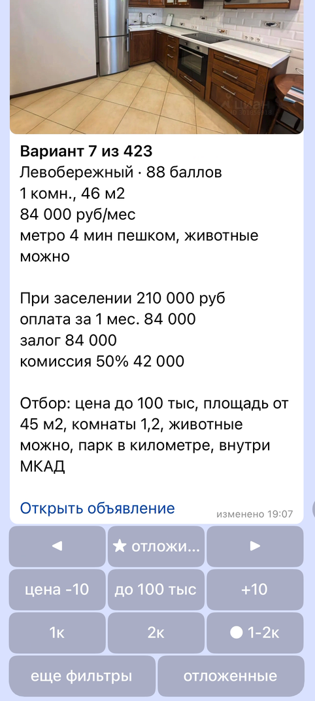
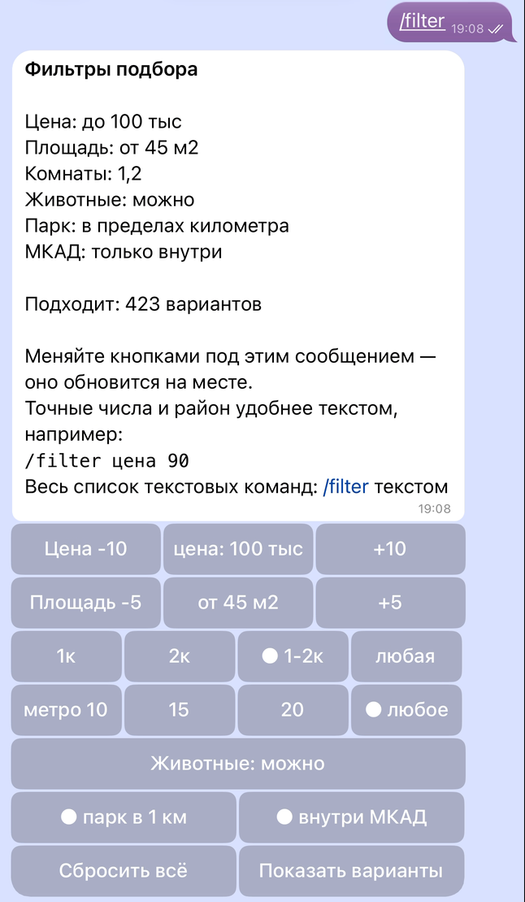
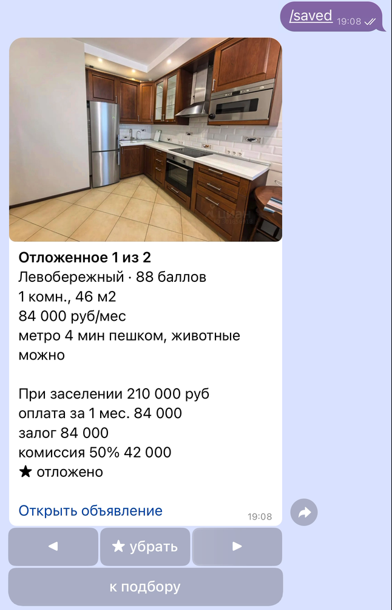

# Бот в телеграме

[← к README](../README.md)


Сбор идет на отдельной машине, которая всегда включена, а человек бывает
в разъездах. Поэтому у панели есть бот в телеграме: он докладывает о
беде сам и выполняет то, за чем иначе пришлось бы идти в терминал.

## Он говорит, когда что-то сломалось

Поводов восемь: упал сбор, упал шаг после сбора, не поднялась база, снят
заклинивший замок, замок снять не удалось, диск ниже двух гигабайт и
ниже пяти, проба площадки не уложилась в срок. Плюс **вечерний пульс**,
итог дня, который приходит всегда:

```
Итог дня 22.10: день покрыт

1-2 комнаты: 17271 из 16500 (104%)
Снятий за день: 0
```

Пульс важнее тревог: он приходит каждый вечер, и его **отсутствие**
единственный способ узнать, что молчит машина, а не рынок.

Так выглядит тревога о диске, команда лечения в ней нажимается.


Одно сообщение на повод за шесть часов, иначе сторож, который ходит раз
в двадцать минут, отправил бы одну и ту же беду семьдесят два раза в
сутки.

## Он чинит то, что ломается чаще всего

Сообщение о беде называет команду, а не инструкцию для терминала: в
поезде консоли нет.

| команда | что делает |
|---|---|
| `/status` | собрано за день, покрытие, свежесть витрин, диск, память |
| `/clean` | вычистить кеш браузера, не трогая куки |
| `/unlock` | снять заклинивший замок |
| `/catchup` | догнать день |
| `/dbup` | поднять упавшую базу |

Команды, которые что-то делают, сами отказываются работать посреди
обхода: второй браузер в том же профиле ломает сессию площадки обоим.
`/unlock` вдобавок не трогает замок, если журнал прогона писался меньше
пяти минут назад: значит, обход жив.

## Он показывает подбор

Подбор приходит одной карточкой: фото, район, балл, комнаты, площадь,
цена, метро, животные и ссылка. Карточка листается кнопками на месте,
чат не засыпается вариантами.

```
[ ◀ ]  [ ★ отложить ]  [ ▶ ]
[ цена -10 ]  [ до 80 тыс ]  [ +10 ]
[ 1к ]  [ 2к ]  [ ● 1-2к ]
[ еще фильтры ]  [ отложенные ]
```

<p>



</p>

Понравившееся откладывается звездой и живет в `/saved`, тоже карточками.
Отложенное ищется по объявлению без фильтров, поэтому не пропадает,
если подорожало или выпало из отбора, а снятое помечается.

Полные фильтры открываются кнопкой «еще фильтры» или текстом
(`/filter цена 90`). Они живут между запусками и **свои у каждого чата**.
Новому чату отбор ставится автоматически (1-2 комнаты и потолок цены по
медиане сегодняшней выдачи), и бот пишет, что поставил его сам: пустой
отбор означал бы не «показать все», а «показать самое дорогое». Балл за
цену в проекте перевернут намеренно, поэтому без потолка наверх лезут
квартиры за три миллиона.

## Он понимает фразу

Вместо кнопок можно написать словами, без команды.

```
двушка до 90 у метро с котом

Ищу так: цена до 90 тыс, комнаты 2, метро до 10 мин, животные можно
```

Из фразы получаются те же фильтры, что ставят кнопки, и подбор сразу
приходит карточкой. Прежние фильтры сохраняются, `/undo`
возвращает их. Если в фразе есть пожелание, для которого фильтра нет
(ремонт, балкон, студия), бот так и пишет, а не пропускает молча.

Разбирают два способа. Первый это правила в коде, они узнают
«однушку», «до 90 тыс», «у метро», склоненный район по справочнику базы.
Второй это GigaChat (<!--n:nl_model-->GigaChat-2<!--/n-->), который получает
список полей и отвечает одним JSON. Ответ модели проходит то же сито,
что и ввод с кнопок: тип, границы, район только из справочника, все
лишнее отбрасывается. Если главный способ ничего не нашел, фраза
уходит второму. Не разобралась ни одним, модель не ответила за 10
секунд или ее ответ не прошел сито, бот показывает кнопки. Лимит 50 фраз в сутки у владелицы и 20 у гостя. Если
Сбер перестал принимать ключ, приходит тревога.

**Какой способ главный, решено до замера.** Подсказка модели и правила
настраивались на 30 отдельных фразах. Тестовые
<!--n:nl_n-->80<!--/n--> фраз и правило выбора («главная модель, если
точных разборов у нее не меньше, чем у правил») ушли в репозиторий
коммитом до прогона, и тест прогнан один раз
<!--n:nl_date-->25 октября 2026<!--/n-->.

| разбор | точно, из <!--n:nl_n-->80<!--/n--> | доля, % | заметил пожелание без фильтра, из <!--n:nl_n-->80<!--/n--> |
|---|---:|---:|---:|
| правила | <!--n:nl_rules-->78<!--/n--> | <!--n:nl_rules_pct-->97,5<!--/n--> | <!--n:nl_rules_flag-->79<!--/n--> |
| GigaChat | <!--n:nl_gigachat-->75<!--/n--> | <!--n:nl_gigachat_pct-->93,8<!--/n--> | <!--n:nl_gigachat_flag-->77<!--/n--> |
| как в боте, главный плюс запасной | <!--n:nl_bot-->78<!--/n--> | <!--n:nl_bot_pct-->97,5<!--/n--> | <!--n:nl_bot_flag-->79<!--/n--> |

Точно значит, что все фильтры совпали с ожидаемыми целиком. Главными
стали <!--n:nl_primary-->правила<!--/n-->, GigaChat разбирает фразу,
когда правила в ней ничего не нашли. Медиана ответа модели
<!--n:nl_latency-->0,35<!--/n--> с.

Чего этот замер не говорит. Фразы написаны мной, и правила писались
человеком, который знает, как такие фразы выглядят. На чужих словах
правила, скорее всего, ошибаются чаще, а модель держится ровнее, поэтому
она и оставлена запасной. Две ошибки правил, найденные тестом
(«минимум 38 квадратов» читалось как минуты до метро, «80-90 тысяч»
терялось), исправлены после замера. Числа выше от первого прогона, до
исправления. Все промахи обоих способов лежат в
[results/nl_eval.json](../results/nl_eval.json).

Через вызов функции, которым GigaChat умеет отвечать по схеме, на
настроечных фразах точных разборов было 11 из 30: числа уходили в поле
«прочее», двушка становилась трешкой. Тот же список полей в подсказке
и ответ обычным JSON дали 30 из 30, поэтому так.

## Он отвечает на вопрос о рынке

```
/ask сколько двушек в Хамовниках подешевело за неделю

Снижения цены за 7 дней до 28.10, двушки, Хамовники

Подешевело объявлений 24, снижений 27
Медианное снижение 5,6%
```

Отвечает не модель. GigaChat выбирает одну из семи заранее написанных
функций и ее параметры: цена сейчас, снижения цены, уходы с площадки,
новые объявления, рейтинг районов по цене за метр, доля объявлений с
животными, свежесть данных. Дальше работает код. Функция берется только
из списка, комнатность от 1 до 5, срок от 1 до 30 дней, район только из
справочника базы. SQL лежит в коде, значения в него идут переменными
psql, а не вклейкой строки. Ответ собирается из строки результата, так
что каждое число в нем взято из базы. Параметр, который не прошел
проверку, бот называет («не учел: район ...»), а не подменяет молча.
Вопрос не по теме получает список того, что бот умеет, а не выдуманный
ответ.

**Какая модель отвечает, решено до замера.** Подсказка настраивалась на
30 отдельных вопросах. На них же выбран способ вызова: родной вызов
функций GigaChat в трех прогонах дал 24, 27 и 25 точных вызовов из 30,
то не вызывая функцию вовсе, то теряя район и срок, а список функций в
подсказке с ответом одним JSON дал 28, 28 и 29. Тестовые
<!--n:ask_n-->60<!--/n--> вопросов (шесть из них не по теме) и правило
выбора модели («GigaChat-2-Pro, если у нее точных вызовов больше хотя бы
на 5 процентных пунктов, иначе GigaChat-2») ушли в репозиторий коммитом
до прогона. Тест прогнан один раз <!--n:ask_date-->28 октября 2026<!--/n-->.

| модель | точно, из <!--n:ask_n-->60<!--/n--> | доля, % | медиана ответа, с |
|---|---:|---:|---:|
| GigaChat-2 | <!--n:ask_lite-->58<!--/n--> | <!--n:ask_lite_pct-->96,7<!--/n--> | <!--n:ask_lite_latency-->0,39<!--/n--> |
| GigaChat-2-Pro | <!--n:ask_pro-->59<!--/n--> | <!--n:ask_pro_pct-->98,3<!--/n--> | <!--n:ask_pro_latency-->0,69<!--/n--> |

Точно значит, что функция и все параметры после проверки кода совпали с
ожидаемыми, а вопрос не по теме получил отказ. Разница меньше порога,
поэтому в боте <!--n:ask_model-->GigaChat-2<!--/n-->: он вдвое быстрее и
тратит более дешевый пакет. Промахи обеих моделей пришлись на вопросы
не по теме: «найди мне двушку до 80 тысяч» обе прочли как вопрос о цене
двушек и показали медиану рынка. Вреда в таком ответе нет, но это не то,
что спрашивали. Все промахи в [results/ask_eval.json](../results/ask_eval.json).

После замера подсказку поправили по промаху на dev: «где дешевле всего
снять однушку» модель читала как вопрос о цене однушек. В подсказку
добавлено правило про «где» и «в каком районе» и один пример, в dev два
новых вопроса. На dev режим JSON дал 32 из 32 в двух прогонах подряд.
Тест повторно не прогонялся, поэтому числа в таблице относятся к
подсказке на 28 октября.

Чего этот замер не говорит. Вопросы написаны мной, и функции придуманы
под те вопросы, которые я задала бы сама. Вопрос, для которого функции
нет, модель склонна натянуть на ближайшую.

## Кому он отвечает

Ролей три. Владелица может все. Гость, перечисленный в `.env`, может только
смотреть подбор, рынок, свежесть данных, свои фильтры. Журнал прогона
гостю не отдается, в нем устройство машины. Чужому не приходит ничего,
даже отказа: ответ подтвердил бы, что бот живой и что-то умеет.

## Как это работает, если машина за NAT

Снаружи к машине сбора не подключиться, и webhook телеграма до нее не
дотянется. Поэтому бот не ждет входящих, а сам раз в минуту спрашивает
телеграм, держа соединение открытым до пятидесяти секунд. Открытых
портов не добавилось ни одного.

Отдельного демона нет намеренно: процесс живет не дольше семидесяти
секунд, дальше его сменяет следующий запуск из `cron`. В этом проекте
уже был зависший процесс, который девятнадцать часов держал замок и чуть
не съел день панели.
