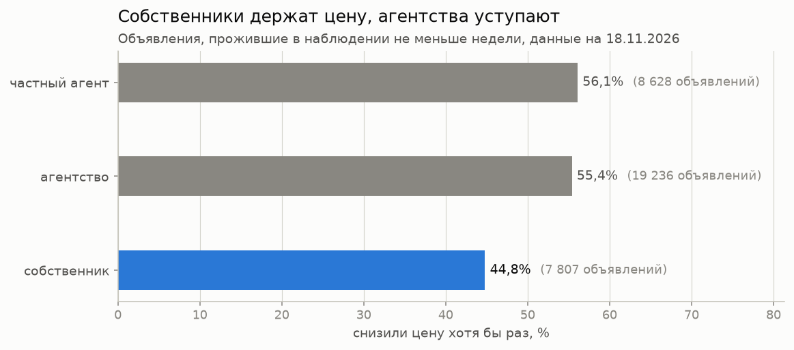
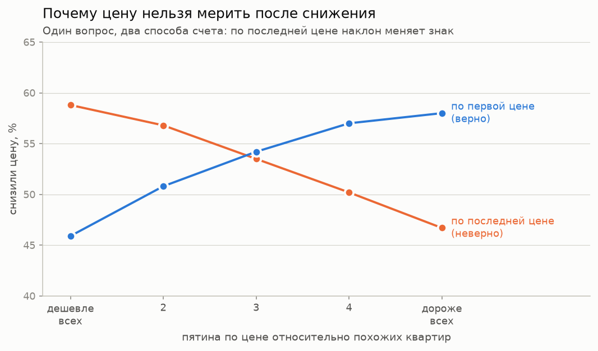

# Кто снижает цену

[← к README](../README.md)

> Данные на **<!--n:dr_date-->18 ноября 2026<!--/n-->**, команда `make drops-analysis`.
> Числа этой страницы, таблица результатов README и плашка на обложке
> берутся из одного файла `results/drops.json`. Первый снимок был
> 04.10.2026 по 13 дням панели, пересчет 18.11 сдвинул разрыв с 9,0 до
> 10,6 п.п. и поменял вывод о цене относительно рынка (ниже).

За <!--n:dr_days-->58<!--/n--> дней панели в сегменте <!--n:dr_cuts-->33 739<!--/n--> снижений цены против
<!--n:dr_raises-->3 382<!--/n--> повышений, то есть примерно **<!--n:dr_ratio-->10<!--/n--> к одному**. Медианная глубина
снижения <!--n:dr_depth_med-->6,0<!--/n-->%, четверть снижений глубже <!--n:dr_depth_q25-->8,2<!--/n-->%.

## Снижает тот, кто продает не свое

<!--n:dr_shares_table-->
| признак | значение | объявлений | снизили цену |
|---|---|---:|---:|
| продавец | частный агент | 8 628 | 56,1% |
| продавец | агентство | 19 236 | **55,4%** |
| продавец | **собственник** | 7 807 | **44,8%** |
| комнат | 1 | 16 589 | 53,2% |
| комнат | 2 | 19 124 | 53,2% |
| животные | разрешено | 9 321 | 55,6% |
| животные | запрещено | 5 633 | 54,1% |
| животные | по договоренности | 748 | 52,7% |
| животные | не указано | 20 011 | 51,8% |
| район | дорогой | 17 520 | 55,0% |
| район | средний | 13 464 | 52,6% |
| район | дешевый | 4 729 | 48,1% |
<!--/n-->

Разрыв между агентством и собственником <!--n:dr_raw-->10,6<!--/n--> процентного пункта, и
вместе с частными агентами это самая большая разница в таблице. Доли
посчитаны только по объявлениям, прожившим в наблюдении не меньше
недели: иначе ответом на вопрос «кто снижает» оказалось бы «кто дольше
висит».

Разрыв не подменяет собой что-то другое. Линейная вероятностная модель с
фиксированными эффектами района, поправкой на комнатность, площадь,
число фотографий, расстояние до метро, животных, срок висения и пятину
первой цены относительно похожих, с ошибками, кластеризованными по
району, на <!--n:dr_lpm_n-->35 671<!--/n--> объявлениях:

<!--n:dr_lpm_table-->
| признак | эффект, п.п. | ошибка | t |
|---|---:|---:|---:|
| **агентство** против собственника | **+12,4** | 0,9 | 13,1 |
| частный агент против собственника | +13,1 | 0,8 | 16,1 |
| животные разрешены | +4,8 | 0,6 | 7,6 |
| животные запрещены | +2,5 | 0,7 | 3,4 |
| две комнаты против одной | +3,3 | 0,9 | 3,7 |
| первая цена дороже всех против дешевле всех | +11,9 | 1,8 | 6,5 |
<!--/n-->

Сырая разница <!--n:dr_raw-->10,6<!--/n--> п.п., с поправкой на все перечисленное
<!--n:dr_adj-->12,4<!--/n--> п.п., 95% интервал <!--n:dr_adj_ci-->10,5-14,2<!--/n-->. Поправки разрыв не съедают, а
скорее увеличивают: собственники чаще сразу просят дороже похожих
квартир (медиана первой цены к похожим 1,13 против 1,04 у агентств,
18.11), а с высокой первой цены снижают чаще. Без этой поправки часть
разрыва пряталась.

Первая цена входит в модель пятинами с 18.11.2026. До того она стояла
одним числом, отношением к медиане похожих, и на свежей панели хвост
этого отношения до 1300 делал коэффициент бессмысленным: это цены с
тремя лишними нулями вроде 85 000 000 вместо 85 000, позже исправленные
продавцом (208 объявлений с отношением больше 3).
Такая правка попадает в снижения цены. С прежней записью разрыв с
поправками на тех же данных получался 10,5 п.п.

## Ловушка, из-за которой ответ получается с обратным знаком

Напрашивающийся вопрос, снижают ли те, кто изначально просил выше
рынка. Напрашивающийся способ счета взять отношение цены объявления к
медиане похожих и посмотреть доли по пятинам.

Так делать нельзя. В витрине лежит **последняя** цена, и объявление,
которое уже снизило цену, из-за этого самого снижения выглядит дешевым
относительно рынка.

<!--n:dr_trap_table-->
| пятина по цене к похожим | по последней цене (неверно) | по первой цене (верно) |
|---|---:|---:|
| дешевле всех | 58,8% | 45,9% |
| 2 | 56,8% | 50,8% |
| 3 | 53,5% | 54,2% |
| 4 | 50,2% | 57,0% |
| дороже всех | 46,7% | 58,0% |
<!--/n-->

Первый расчет говорит «дешевые снижают чаще», от <!--n:dr_last_lo-->58,8<!--/n-->% до
<!--n:dr_last_hi-->46,7<!--/n-->%. Второй говорит обратное: от <!--n:dr_first_lo-->45,9<!--/n-->% у тех, кто
сразу просил дешевле похожих, до <!--n:dr_first_hi-->58,0<!--/n-->% у тех, кто просил дороже
всех, и модель с поправками держит этот разрыв
(<!--n:dr_q5_adj-->+11,9<!--/n--> п.п. у верхней пятины против нижней). **Просившие выше рынка
снижают чаще, а тип продавца добавляет к этому свое.**

На снимке 04.10 по 13 дням панели наклона по первой цене почти не было,
и вывод звучал как «цена относительно рынка ничего не говорит о торге».
Почему наклон проявился, по этим данным не сказать: панель стала вчетверо
длиннее, и в нее вошли другие объявления. Ловушка от этого не исчезла: неверный счет по-прежнему
дает обратный знак.

## Через сколько дней

<!--n:dr_cut_table-->
| возраст, дней | еще не снижали цену |
|---:|---:|
| 3 | 90,5% |
| 7 | 74,0% |
| 14 | 52,6% |
| **16** | **48,5%** |
| 21 | 40,6% |
| 30 | 31,0% |
| 45 | 20,0% |
<!--/n-->

Медиана до первого снижения <!--n:dr_cut_median-->16<!--/n--> дней, позже медианы срока жизни
объявления (14 дней, [срок жизни](survival.md)): многие объявления уходят
из выдачи раньше, чем доходят до снижения.

Читать таблицу надо с поправкой: объявление, снятое на третий день,
здесь цензурировано, а не «не снизило цену». Среди тех, кто доживает,
снижение обычное дело.

## Чего эти числа не говорят

Что агентство «готово торговаться». Мы видим изменение цены в
объявлении, а не разговор с арендатором. Собственник может уступить при
встрече и не тронуть объявление; агентство может снижать цену по
внутреннему регламенту, не собираясь уступать дальше.
