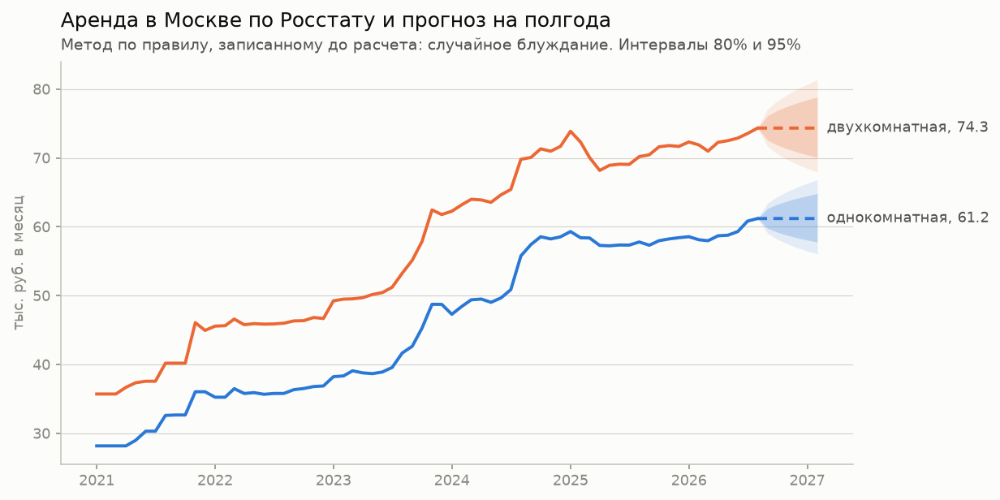
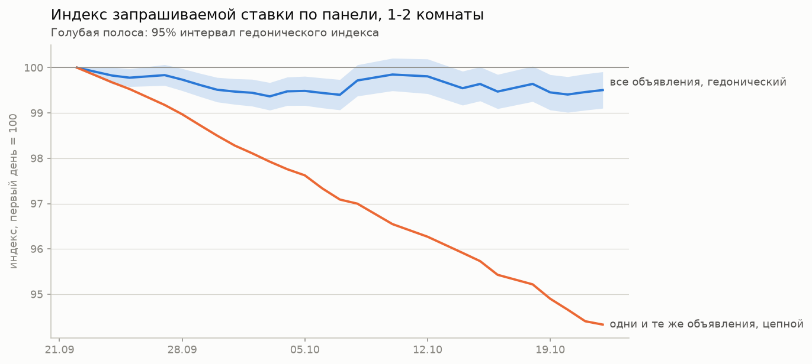
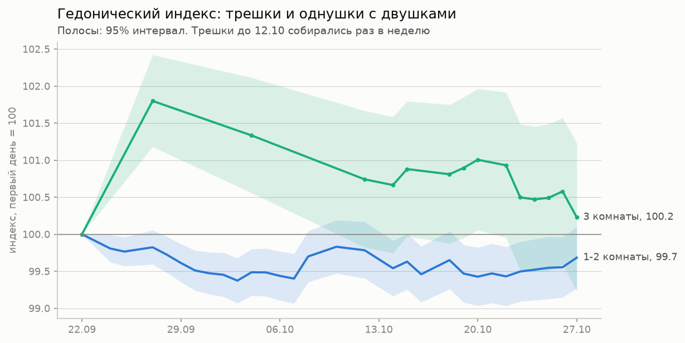

# Индекс аренды и прогноз

[← к README](../README.md)

Личный вопрос перед переездом в том, когда входить на рынок и сколько
закладывать. Ответ собран из двух частей. Ряд Росстата за
<!--n:fc_months-->140<!--/n--> месяцев дает прогноз, собственная панель
служит текущим замером. Панель слишком коротка для прогноза, и подгонять
модель под месяц наблюдений было бы самообманом.

Результаты лежат в репозитории файлами и проверяются без базы,
`results/forecast.json`, `results/backtest.csv`, `results/panel_index.json`.
Пересчет командами `make forecast` и `make index`.

## Прогноз по Росстату

Правило выбора модели записано в `src/forecast.py` и запушено отдельным
коммитом до первого расчета (`27f4134`). Сервер GitHub записал пуш
23.10.2026 в 18:14:58 МСК, первый расчет (`2d8d875`) пришел в 18:38. До
переписывания истории 28.10 коммит назывался `3c6ba1e`, дерево файлов
совпадает побайтно; событие пуша сохранено в
[preregistration_pushes.json](preregistration_pushes.json). Кандидатов четыре, случайное
блуждание, сезонный наивный, ETS и SARIMA. Оценка скользящим началом,
24 начала, горизонты от одного до шести месяцев, MAPE по уровню
номинального ряда, среднее по однушкам и двушкам. Сложная модель
заменяет простой ориентир, только если ошибается хотя бы на 10% реже и
ее 80%-интервал накрывает факт в 70-90% случаев.

<!--n:fc_backtest_table-->
| модель | MAPE, % | покрытие 80%, доля | покрытие 95%, доля |
|---|---:|---:|---:|
| случайное блуждание | 1,92 | 0,91 | 0,99 |
| сезонный наивный | 6,43 | 0,74 | 0,93 |
| ETS | 3,24 | 0,78 | 0,93 |
| SARIMA | 2,70 | 0,80 | 0,93 |
<!--/n-->

По правилу выбрано <!--n:fc_chosen-->случайное блуждание<!--/n-->.
Ни ETS, ни SARIMA не обыграли прогноз «как в прошлом месяце». На первом
месяце все почти равны, к шестому отставание в среднем растет: модели
продолжают рывок цен 2023-2024 годов, которого дальше не было. Сезонный наивный хуже
всех, потому что год назад рынок стоял на другом уровне. Интервал
случайного блуждания шире нужного (накрывает факт чаще заявленных 80%),
то есть он скорее осторожен.

<!--n:fc_forecast_table-->
| комнат | август 2026, руб. | прогноз на февраль 2027, руб. | 80% | 95% |
|---|---:|---:|---|---|
| 1 | 61 205 | 61 205 | 57 786 - 64 825 | 56 055 - 66 827 |
| 2 | 74 341 | 74 341 | 70 098 - 78 840 | 67 951 - 81 331 |
<!--/n-->

Читать так. Лучшая оценка на полгода вперед равна нынешнему уровню, а
80%-интервал шириной около шести процентов в обе стороны. За последний
год номинальная ставка однушки выросла на
<!--n:fc_yoy_1-->5,9<!--/n-->%, в реальном выражении на
<!--n:fc_yoy_real_1-->1,1<!--/n-->%.

**Сезонность слабая и неустойчивая.** Декомпозиция STL за последние
три года дает размах около <!--n:fc_season_amp-->3,7<!--/n-->% между
лучшим и худшим месяцем, но месяц пика в номинальном и реальном ряду
разный. Выигрыша от того, чтобы подгадать месяц переезда, в этих данных
не видно.

## Индекс по панели

Два способа на одной выборке, <!--n:ix_days-->30<!--/n--> дней
успешного сбора, <!--n:ix_rows-->464 589<!--/n--> наблюдений однушек и
двушек без дублей, посуточных и выбросов.

* **Цепной по одним и тем же объявлениям.** Шаг между соседними днями
  сбора равен среднему изменению логарифма цены у объявлений, бывших в
  выдаче оба дня. За месяц <!--n:ix_chain-->−6,5<!--/n-->%.
* **Гедонический.** Регрессия логарифма цены на фиктивные по дате,
  признаки квартиры и эффекты района, ошибки кластерные по объявлению.
  За тот же месяц <!--n:ix_hed-->−0,32<!--/n-->%, 95%-интервал
  [<!--n:ix_hed_ci-->−0,73; +0,10<!--/n-->].

Расхождение двух линий само по себе результат. Объявление, которое
остается на рынке, за месяц дешевеет примерно на шесть процентов,
потому что его цену снижают. Рынок в целом почти стоит, потому что
новые объявления входят по прежним ценам. Цепной индекс поэтому меряет
жизнь объявления и для уровня рынка не годится.

По правилу, записанному заранее, гедонический индекс
<!--n:ix_flat_verdict-->считается плоским, потому что интервал накрывает ноль<!--/n-->.
Величина меньше полупроцента, день ото дня индекс гуляет на <!--n:ix_sd_day-->0,09<!--/n-->% со
стойкой автокорреляцией, и его путь не монотонный. Ошибки, кластерные
по объявлению, не учитывают общий для дня шум состава выдачи, поэтому
интервал скорее узок. Осторожный вывод такой. За месяц панели
запрашиваемая ставка сдвинулась меньше чем на полпроцента, и это меньше
половины типичного месячного движения по Росстату.

**С какого месяца панель начнет различать.** Минимально различимое
месячное изменение по дневному шуму <!--n:ix_mde-->0,14<!--/n-->%, а
типичное месячное движение по Росстату <!--n:ix_rosstat_mom-->1,07<!--/n-->%.
Значит, различать панель сможет с первой пары полных месяцев, октября и
ноября 2026, то есть после 30 ноября. Для сезонности нужен год, это
сентябрь 2027.

**Связка с Росстатом пока предварительная.** Полных месяцев панели, по
которым у Росстата уже есть значение, ноль. Сентябрь панели неполный, а
октябрь Росстат еще не опубликовал. Первое сравнение будет «ноябрь к
октябрю». До тех пор никаких выводов о совпадении двух источников нет.

## Трешки

Своего ряда у Росстата для трешек нет: в справочнике ЕМИСС из аренды
квартир есть только однокомнатная и двухкомнатная (проверено
28.10.2026). Поэтому прогноза по трешкам нет, есть только замер по
панели.

Протокол тот же, что для однушек и двушек, отдельным рядом, только 3
комнаты: 4+ комнат мало, и они слишком разные. День засчитывается, если
в нем успешно обойдена корзина трешек. До 12.10 полный обход шел раз в
неделю, поэтому начало ряда идет недельными шагами. Выборка
<!--n:ix3_days-->15<!--/n--> дней, <!--n:ix3_rows-->60 517<!--/n-->
наблюдений <!--n:ix3_offers-->8 409<!--/n--> объявлений.

Гедонический индекс трешек от первого дня до последнего
<!--n:ix3_hed-->+0,23<!--/n-->%, 95%-интервал
[<!--n:ix3_hed_ci-->−0,77; +1,24<!--/n-->], по правилу
<!--n:ix3_flat_verdict-->плоский, интервал накрывает ноль<!--/n-->. Цепной
по одним и тем же объявлениям <!--n:ix3_chain-->−5,8<!--/n-->%, как у
однушек и двушек: оставшимся снижают цену. Путь ряда не ровный: через
неделю после первого дня индекс стоял на <!--n:ix3_peak-->+1,8<!--/n-->%
и с тех пор сползает. Начало построено по трем недельным точкам, и
первый день один задает базу, поэтому подъем в начале я за рост рынка
не считаю.

Минимально различимое месячное изменение <!--n:ix3_mde-->0,24<!--/n-->%,
оно посчитано только по дневному хвосту ряда, <!--n:ix3_tail_days-->9<!--/n-->
дней: недельный шаг начала раздул бы дневной шум. Сравнивать его не с
чем, кроме типичного месячного движения Росстата по однушкам и двушкам,
<!--n:ix_rosstat_mom-->1,07<!--/n-->%, и это сравнение условное.
